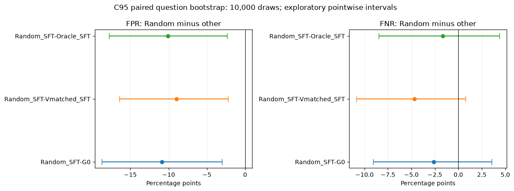
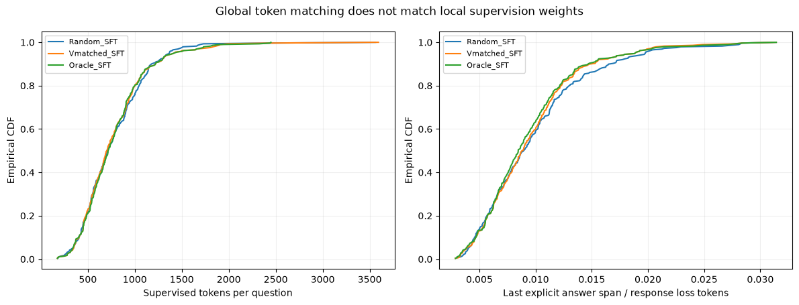

# 四分支缓存分析及原两轮V0误判初审

**本轮发现：G正确率没有明确差异，但Random的FPR较低，不能把全部现象概括成随机波动。**独立实现先精确重现原2000次按题区间，再扩至10000次。逐题监督检查没有发现prompt泄漏或最终答案被mask，但总体token匹配没有匹配逐题监督权重。原A池另有缺图及参考目标疑点，必须与正常数学错例区分。

本轮为CPU只读缓存分析：没有训练、生成、新V评分或T读取。完整结果均保留原标签，题目问题只做整题排除的影子敏感性统计。

## 1. Random与其他分支的FPR/FNR成对区间

| Random−其他 | 指标 | 差值/百分点 | 成对95%区间/百分点 |
| --- | --- | --- | --- |
| Random_SFT-G0 | FPR | -10.88 | [-18.70, -3.02] |
| Random_SFT-G0 | FNR | -2.61 | [-9.09, +3.56] |
| Random_SFT-Vmatched_SFT | FPR | -8.99 | [-16.42, -2.23] |
| Random_SFT-Vmatched_SFT | FNR | -4.69 | [-10.86, +0.75] |
| Random_SFT-Oracle_SFT | FPR | -10.07 | [-17.78, -2.33] |
| Random_SFT-Oracle_SFT | FNR | -1.66 | [-8.49, +4.39] |

| C95模型 | TP/FN/FP/TN | FPR | FNR | 接受比例 |
| --- | --- | --- | --- | --- |
| G0 | 131/23/114/94 | 54.81% | 14.94% | 66.84% |
| Random_SFT | 128/18/94/120 | 43.93% | 12.33% | 60.26% |
| Vmatched_SFT | 117/24/118/105 | 52.91% | 17.02% | 64.47% |
| Oracle_SFT | 123/20/115/98 | 53.99% | 13.99% | 65.00% |

按整题重采样，四候选一起进入，各分支共用题目索引；10000次、种子20261022。区间是探索性点位95%，未作多重比较校正、不含训练种子不确定性。C95排除原参考疑点整题；原C96和reference=1影子视图同样导出，不挑选有利口径。未知不当错例，未知标签识别界另列。

V0参数、提示和0.5阈值完全相同；FPR分母是各G自身的已知错误集合，较低FPR反映该回答分布下更少误接受，不代表V0本身升级或G更强。接受比例下降、错误题组成以及同题错误文本变化都可能有关。

| Random−其他 | 共同错题组成项/pp | 共同错题类内项/pp | 进入/pp | 退出/pp | 总差/pp |
| --- | --- | --- | --- | --- | --- |
| Random_SFT-G0 | -1.06 | -9.32 | +0.93 | -1.44 | -10.88 |
| Random_SFT-Vmatched_SFT | -0.23 | -6.51 | +0.00 | -2.24 | -8.99 |
| Random_SFT-Oracle_SFT | -0.79 | -9.27 | +0.93 | -0.94 | -10.07 |

这项分解精确相加，但每题最多4条错例，类内值粗糙；它是描述，不是语义错误根因或独立因果效应。不同回答上V接受率改变，不等于固定文本上V遗忘。

## 2. 同题抽查：过程、长度、解法与错误类型

95题全部逐题计数与长度导出；目的抽查6道C题、每题Random/Vmatched/Oracle同一候选索引，共18条完整回答。另保留这6题所有四分支×4候选共96条原文。相同candidate_index仅作描述，参数改变后不代表同一采样路径的因果配对。

- 有理方程：Random错误通分后出现明显矛盾，被V拒绝；另外两组推导更连贯，却在约分时漏掉零分子分支，被V接受。三组都错，但错误的可识别性不同。
- 汽车计数：同为答案11，Random主要推导成立；Vmatched有20=17矛盾，Oracle最后一步缺中间依据。另两组被拒，在当前最终答案任务中仍是FN。
- 立方根：三组代数推导均通过此次检查，Random仍被拒；半回文也有简短正确推导被拒，不能用过程错误解释所有FN。
- 最小合数：Random把已分解为53×59的3127说成质数，丢掉正确解；另外两组正确。
- 三平方：Random/V漏掉(3,6,6)；Oracle最终3正确，但前文反向不等式和排序条件不成立。不能把最终答案Oracle等同于过程Oracle。

每例的原文引用、数学证据、完整回答、判定和长度见[直接初审全文](case_reviews.md)。均标为助手初审，人工复核待审；定向案例不能估计总体错误类型比例。

## 3. 逐题监督token与loss mask

| 分支 | 样本 | loss token | 最短/中位/最长 | prompt泄漏 | assistant空洞 |
| --- | --- | --- | --- | --- | --- |
| Random_SFT | 289 | 224951 | 178/706/3563 | 0 | 0 |
| Vmatched_SFT | 289 | 225565 | 176/705/3593 | 0 | 0 |
| Oracle_SFT | 289 | 225565 | 176/717/2449 | 0 | 0 |

逐条重建3个匹配分支及原2轮训练共1868条张量，核对input IDs、shift后的labels、attention、完整assistant目标、显式答案片段和结束token。未见prompt参与损失、assistant中间被静默mask，或最后显式答案未监督。多盒和无标记另计；最后显式片段不是语义正确性或过程认证。

训练microbatch=1，先对每条回答的有效token平均，再按当前累积组实际样本数m平均：

L_step=(1/m) Σ_q [(1/L_q) Σ_j CE(q,j)]。

所以单token的loss系数为1/(mL_q)。同一题选300还是1500 token的回答，每个token系数相差5倍；总token一致并不能消除这种差别。短回答里最终答案片段占比也往往更大。这里是损失代数系数，不是AdamW实际梯度贡献或因果归因。

| Random相对分支 | 相同候选数 | 逐题token绝对差均值/最大 | 每token系数比范围 | 超2倍或低于1/2的题数 |
| --- | --- | --- | --- | --- |
| Vmatched_SFT | 68 | 178.1/2972 | 0.168–5.786 | 18 |
| Oracle_SFT | 77 | 155.4/2965 | 0.168–3.230 | 15 |

289条分为36组×8加末组1条。末条独占完整优化器步，样本loss系数是普通组中单条的8倍；三组题单、顺序、末题相同，这是共同设置，不能单独解释组间差异。原500/501条的末组分别4/5条，也已列出。

## 4. 原两轮反馈中FP和FN的可观测原因

两轮指G0_A经V0筛选后训练G1，以及G1_A经V0筛选后训练G2。共4800条A候选重新汇总；不把C评估误判混成A训练筛选误判。FP是最终错答被接受，FN是最终对答被拒。

| 反馈轮次 | 视图 | FP | FN | FPR | FNR |
| --- | --- | --- | --- | --- | --- |
| G0->G1 | original_A600 | 656 | 100 | 45.52% | 12.61% |
| G0->G1 | exclude_missing_image | 654 | 100 | 45.51% | 12.61% |
| G0->G1 | exclude_image_and_suspect_reference | 650 | 100 | 45.36% | 12.61% |
| G1->G2 | original_A600 | 676 | 97 | 48.63% | 11.47% |
| G1->G2 | exclude_missing_image | 672 | 97 | 48.48% | 11.47% |
| G1->G2 | exclude_image_and_suspect_reference | 668 | 97 | 48.34% | 11.47% |

每轮直接初审3条FP和3条FN，共12条。FP中有边界多加1、把3天休息缩成1天、忽略排列谷底约束、把32–39日当真实日期、误用几何距离公式、丢掉连分数层级。说明V会接受形式顺畅但遗漏约束/情况的错误。

FN分两类：一类最终答案正确但正文错误或冲突，例如正文推到2005却盒中写1，正文算1575却盒中写1120，或给出的质数配对构造不成立；另一类所检查主要推导成立，例如Jimmy固定座位下6720−1680=5040仍被拒。当前任务只判最终答案，前一类也必须记FN；若改判完整有效解答须另设任务，不能回头改口径。

**原V0只有A/B条件似然，没有理由文本。**本次“原因”限于可见数学问题与失败模式，不能声称V内部一定因某一步错误而拒绝，也不把事后分析当作V真实推理。

## 5. 新发现的数据问题与敏感性

A缺图题4b578eb4…只说三幅天平图，却没有提供图或图示关系；两轮实际选中了凭空构造平衡方程的回答。应把整题候选与正常G数学错答分开。系数和题93eb13ae…字面多项式的系数和应为0（代a=b=c=1），冻结参考9有目标/参考冲突，标为疑点，尚未正式修订。

| 反馈轮次 | 问题 | 入训条数 | 属于共同289题 |
| --- | --- | --- | --- |
| G0->G1 | missing_required_image | 1 | False |
| G0->G1 | literal_target_reference_conflict | 1 | False |
| G1->G2 | missing_required_image | 1 | False |
| G1->G2 | literal_target_reference_conflict | 1 | False |

| 反馈轮次 | 影子视图 | 实际样本 | 正确/错误/未知 | 已核验错误率 |
| --- | --- | --- | --- | --- |
| G0->G1 | original_A600 | 500 | 223/259/18 | 53.73% |
| G0->G1 | exclude_missing_image | 499 | 223/258/18 | 53.64% |
| G0->G1 | exclude_image_and_suspect_reference | 498 | 223/257/18 | 53.54% |
| G1->G2 | original_A600 | 501 | 229/259/13 | 53.07% |
| G1->G2 | exclude_missing_image | 500 | 229/258/13 | 52.98% |
| G1->G2 | exclude_image_and_suspect_reference | 499 | 229/257/13 | 52.88% |

整题排除仅用于本次敏感性汇总；原候选、真值、训练和模型均不重写，既有模型仍接受过这些样本。未对全部A题目作完整质量认证，不能声称只有这两题有问题，也不能用这少量记录解释整条训练轨迹。

## 交付文件

- cache_followup_review.xlsx：13张表，区间、逐题监督、两轮A反馈及30条全文初审。
- cache_followup_figures.pdf及figures/：3张图。
- case_reviews.md / reviewed_cases_full.jsonl：完整证据与助手初审。
- A_misclassified_full.jsonl：原两轮所有缓存FP/FN，未冒称全部过程已审查。
- exact_checks.json / source_integrity.json / validation.json：精确复算与来源完整性。

完成UTC时间：2026-10-24T08:51:28.661063+00:00。

## 补充：A反馈池确有FPR上升信号，不能与独立C混为一谈

表中G0→G1、G1→G2表示两次生成—筛选—训练流程；两行的V0统计分别来自G0_A和G1_A，比较的是G0与G1输出，不是已经生成的G1与G2输出。

| 题池/口径 | 指标 | G1−G0/百分点 | 成对95%区间/百分点 |
| --- | --- | --- | --- |
| A600_original | FPR | +3.11 | [+0.09, +6.04] |
| A600_original | FNR | -1.14 | [-4.09, +1.77] |
| A600_original | balanced_accuracy | -0.98 | [-3.11, +1.11] |
| A599_no_missing_image | FPR | +2.97 | [-0.05, +5.95] |
| A599_no_missing_image | FNR | -1.14 | [-4.12, +1.72] |
| A599_no_missing_image | balanced_accuracy | -0.91 | [-2.98, +1.18] |
| A598_no_image_or_suspect_reference | FPR | +2.98 | [-0.04, +6.00] |
| A598_no_image_or_suspect_reference | FNR | -1.14 | [-4.00, +1.79] |
| A598_no_image_or_suspect_reference | balanced_accuracy | -0.92 | [-3.00, +1.22] |
| C95_independent_of_G_training | FPR | -0.51 | [-8.01, +6.95] |
| C95_independent_of_G_training | FNR | +0.89 | [-4.66, +6.46] |
| C95_independent_of_G_training | balanced_accuracy | -0.19 | [-4.70, +4.48] |

**结论需明确限定：原A600反馈池的FPR上升3.11个百分点，探索性点位95%区间[+0.09,+6.04]，支持该池中误接受风险上升；不能笼统表述成没有跨轮退化信号。**FNR下降约1.14个百分点，其区间跨0。若两类错误等权，平衡准确率点估计下降约0.98个百分点，但其区间同样跨0；不同条件分母的两个百分点不能当作实际错判条数直接相减。

排除已发现问题题目后，FPR升幅仍约2.98个百分点，区间仅略跨0；效应点估计几乎不变，不能据此宣布退化消失，但统计证据处于边界。所有区间均未作多重比较校正，且不包含重新训练种子的变异。

A是实际用于G反馈更新的题池，因此这是训练题域上的更新后诊断。独立于G训练的C95上，原G0→G1的FPR差为−0.51个百分点，区间[−8.01,+6.95]，未复现同方向上升，区间也较宽。C已被反复用于开发，不能称为未触碰的最终测试。

**当前可以支持“A反馈池出现固定V误接受风险上升”，尚不能外推为独立题上稳定退化，更不能归因为G能力提升导致V失效。**问题组成、具体错误文本变化和训练题域效应仍需区分。补充计算只读A/C缓存，T未读取，无GPU使用。
