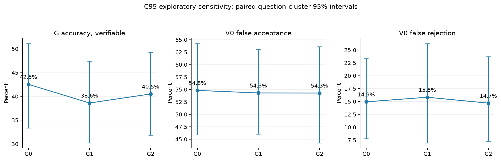
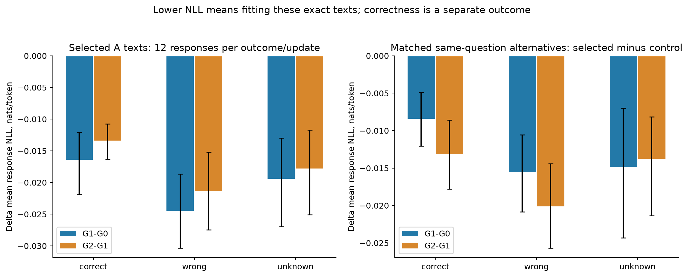
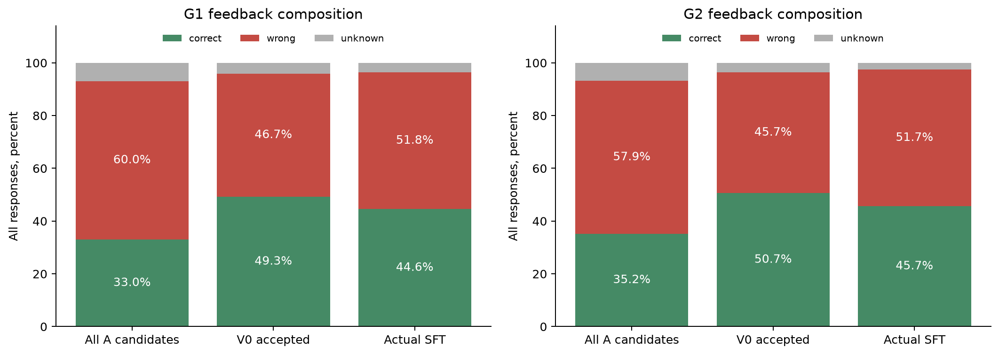
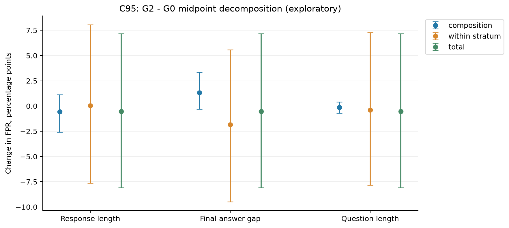
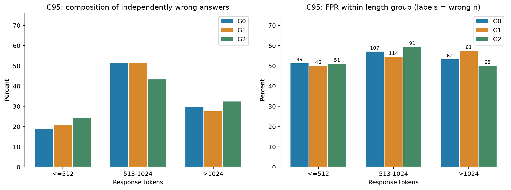
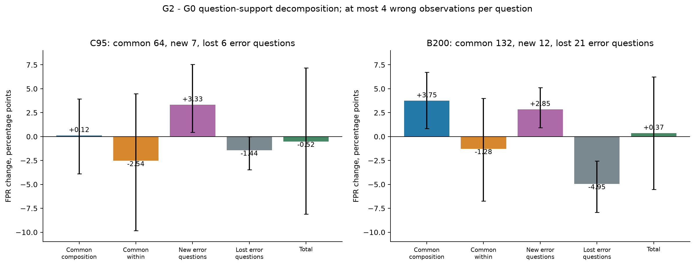
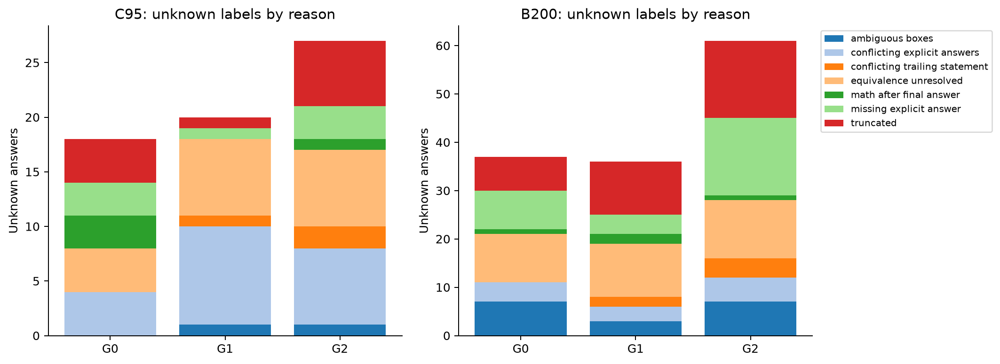
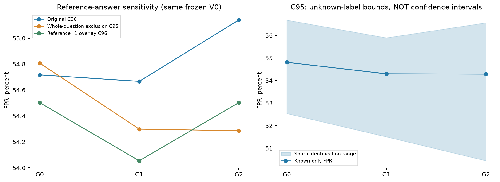

# 为什么本次没有检出明显恶化：竞争性解释诊断

**更符合现有证据的表述是：G确实拟合了所选反馈，但尚未显示稳定的能力提升或更难验证的错误分布；V0误接受率的变化又小于当前估计的不确定性。不能据此推断“验证器跨轮泛化很好”。**

本报告将生成器变化、反馈质量、错误组成和测量问题分开检查。C为主分析，B为单独补充；本次发现C一题参考答案疑点，因此新增C95整题排除敏感性视图。它是探索性分析修订，不覆盖冻结C96结果，也不修改正式标签、训练样本、模型、V0或阈值。T未读取。

## 先报告一个真实的测量问题

C题 `dapo:train:24d751b7-4429-4605-9754-d1451911fb26` 问：若整数x,y满足x³−y³=xy+61，求全部可能x的和。冻结参考为6；精确检查得到全部整数解只有(-5,-6)、(6,5)，故所求和为1。数值6恰为正解x，但不是所有整数x之和；源答案为何如此尚未查明。

令d=x-y,u=x+y，原式等价于(3d-1)u²+d²(d+1)=244。d≤0时左侧非正；d≥1时d²(d+1)≤244，故1≤d≤5。逐一检查u²并要求u与d同奇偶，只有d=1,u=±11；x=-5,6，和为1。

原12条回答和原标签全部保留于`reference_suspect_all12.jsonl`。主诊断暂按题排除该题全部12条，另单列“原C96”和“仅把该题参考改为1”的影子核验结果；未知仍为未知，不借机放宽解析规则。此证明与精算属于助手初审，等待用户复核后才能正式修订参考清单。

| 视图 | G0 FPR | G1 FPR | G2 FPR | G2−G0/百分点 |
| --- | --- | --- | --- | --- |
| Original C96 | 54.72% | 54.67% | 55.14% | +0.42 |
| Whole-question exclusion C95 | 54.81% | 54.30% | 54.29% | -0.52 |
| Reference=1 overlay C96 | 54.50% | 54.05% | 54.50% | +0.00 |

原C96的+0.42个百分点变为C95的−0.52个百分点；参考=1影子视图则恰为0。**一题就能改变点估计方向**，但三种视图都没有支持明显单向恶化。不能选择最有利视图替代原结果。

此外精确复算了有理方程、进制递推、三平方分解、彩色铺砖、车牌计数、红色四门车和实数幂方程等7题，所检参考一致；抽查并非全数据的参考答案认证。几何及较复杂计数只核查了明确局部错误的案例，未声称完成所有题的全解。

## 解释一：G的变化是否不足

| C95 | 正确/错误/未知 | G正确率（可核验） | 正确/全部输出 | 4候选至少1对的题占比 | 输出均长 |
| --- | --- | --- | --- | --- | --- |
| G0 | 154/208/18 | 42.54% | 40.53% | 56.84% | 848.7 |
| G1 | 139/221/20 | 38.61% | 36.58% | 52.63% | 820.9 |
| G2 | 143/210/27 | 40.51% | 37.63% | 53.68% | 882.5 |

C95可核验正确率42.54%→38.61%→40.51%，没有稳定提高；G2−G0为−2.03个百分点，按题成对95%区间[−7.10,+2.84]。B200相应41.81%→42.28%→43.03%，差值+1.22个百分点，区间[−2.32,+4.89]。B的正确/全部回答却39.88%→39.75%，因此不能只根据可核验分母宣布增强。至少一条正确的4候选覆盖只是观测命中率，不把未知当错，也不冒称总体真实pass@4。

但“没增强”不等于“没变化”：C95的G0/G2同题同候选索引共有341个双方可核验对，只有165个最终答案相同，全文相同仅1条；36个从对转错，25个从错转对。候选索引配对只是描述，同种子不保证参数变化后每个采样路径对应同一个随机实验。单条训练轨迹也不能刻画训练随机性。

固定文本似然探针进一步证实更新有可测的拟合效果。它支持“参数更新并非空跑”，却不能证明数学能力或针对V的对抗性变化足够强。当前证据更支持“能力变化不足/方向不稳定仍是可行解释”，不能断言所有回答分布都没有移动。

## 解释二：G从高噪声反馈中学到了什么

| 用于更新 | 原A全部候选错误率 | V0接受池错误率 | 实际SFT错误率 |
| --- | --- | --- | --- |
| G1 | 64.50% | 48.63% | 53.73% |
| G2 | 62.16% | 47.44% | 53.07% |

以上错误率均只以可核验样本为分母，完整正确/错误/未知计数见Excel。V0把原A约62%–65%的错误率降至接受池约47%–49%，因此“实际SFT错误率超过50%”不能单独推出反馈比原G更差或完全无效。另一方面，每题至多随机1条让题目权重发生变化，实际SFT的错误率约53%，确实比按候选计数的接受池更差；不能用整个接受池质量代替实际训练质量。

两轮实际监督token中，冻结标签为错误的占56.17%和54.96%。这不是梯度贡献率：原目标按每条回答的平均token loss再对样本平均，长回答不简单按token数增加同等倍数权重。两轮有465道共同入选题，其中444道两轮标签均已知；192道两轮都选错，84道重复了同一个错误最终答案。重复错例提供了可研究的反馈延续现象，但不单凭它宣布错误记忆是所有变化的原因。

### 新增的只读似然探针

固定158条文本：两轮实际A入选样本各抽正确/错误/未知12条，共72条；同题、同标签且V0接受但未入选的54条替代回答；C中G0 candidate0的正确/错误各16条，共32条。按预定哈希抽样，抽样清单在GPU评分前保存。所有158条在G0/G1/G2下都评分，共474次。诊断用真值分层不回流训练或筛选；B/T不进入此探针。

沿用原BF16、SDPA和精确response-only模板，完整文本含assistant结束符，逐token计算交叉熵。没有生成、训练、梯度、V0重评分或截断；NLL是按回答先求token平均，再跨回答平均，单位nats/token。负ΔNLL表示该文本变得更容易被复现。

| 实际更新 | 入选正确文本ΔNLL | 入选错误文本ΔNLL | 入选未知文本ΔNLL |
| --- | --- | --- | --- |
| G1 | -0.01642 | -0.02446 | -0.01941 |
| G2 | -0.01338 | -0.02136 | -0.01779 |

同题同标签匹配对照避免直接比较12条入选与较少替代回答的均值。错误文本中，G1的“入选ΔNLL−替代ΔNLL”为−0.01552（10对，95%区间[−0.02083,−0.01055]）；G2为−0.02009（9对，[−0.02567,−0.01440]）。正确文本同样存在入选拟合优势。**G在拟合所选文本，对错误回答也如此；这一结果不等于错误发生率必然增加。**

这些替代回答不是随机分配的无噪声训练分支，A同题本来也被训练，C仅为开发诊断。没有运行“等量等长度的更干净反馈”训练对照，因此不能据此把未增强因果归结为噪声、过拟合或训练不足其中之一。

## 解释三：总体FPR是否掩盖组成和类内变化

令 $w_{tk}=P_t(k\mid Y=0)$，$p_{tk}=P_t(V_0接受\mid Y=0,k)$。有 $FPR_t=\sum_k w_{tk}p_{tk}$。采用对起止轮次对称的精确分解：

$$\Delta FPR=\underbrace{\sum_k(w_{tk}-w_{0k})(p_{tk}+p_{0k})/2}_{组成项}+\underbrace{\sum_k(p_{tk}-p_{0k})(w_{tk}+w_{0k})/2}_{类内项}.$$ 

全量使用三套可重复的可观测分组：回答长度≤512、513–1024、>1024；错误最终答案绝对偏差=1、2–10、其他；题目提示长度≤128、129–256、>256。答案偏差用冻结标准答案定义，只作描述，不能称为推理错误根因；题目长度也不是题目难度。这三套分解是同一总变化的不同视图，不能把不同分组的项再相加。

| C95/G2−G0 | 组成项/百分点 | 类内项/百分点 | 总变化/百分点 |
| --- | --- | --- | --- |
| output_length | -0.56 | +0.04 | -0.52 |
| answer_gap | +1.32 | -1.84 | -0.52 |
| question_length | -0.13 | -0.40 | -0.52 |

最终答案偏差分层中，组成项+1.32和类内项−1.84个百分点发生数值抵消；但两者95%区间分别约[−0.30,+3.36]和[−9.48,+5.57]，都跨0，尚不足以认定可靠的抵消机制。长度分解的组成项−0.56、类内项+0.04，幅度也小。B上的三套分解另列，未与C合并。

每次抽整题、保留同题4候选，跨G共用重采样索引，2000次探索性百分位95%区间；不做多重比较校正。某层只在单轮出现时，另一轮类内率不可识别，记NA而不填0；两轮都无样本的层贡献0。答案偏差C分解有效重采样1999/2000，B题长分解有效1936/2000，完整计数随表保存，避免隐藏支持不足。

C95同题同索引且两轮都错的166对中，V0由拒绝转接受24对，同时由接受转拒绝也是24对。这是总体稳定下局部变化抵消的直接描述；它没有控制具体回答文本相同，不能称为V参数遗忘或归结于某一种数学错误。

### 进一步按独立题目分解，并显式处理进入/退出错题集

若直接令k为题目，部分题在某一轮没有已核验错误，不能凭空填该轮类内FPR。因此只在两轮都观察到错例的共同题集计算对称组成/类内项，再加“新进入错题集的误接受质量”和“退出错题集的旧误接受质量”。四项之和精确等于总体ΔFPR；未观察到错误不代表该题真实错误概率为0。

| G2−G0/百分点 | 共同题组成项 | 共同题类内项 | 新错题进入项 | 旧错题退出项 | 总变化 |
| --- | --- | --- | --- | --- | --- |
| C | +0.12 | -2.54 | +3.33 | -1.44 | -0.52 |
| B | +3.75 | -1.28 | +2.85 | -4.95 | +0.37 |

C95的共同错题64道，进入7道、退出6道；B200共同132道、进入12道、退出21道。这样能直接看见跨题组成的变化，而不只看全局均值。每题每轮只有最多4个错误观测，类内率很粗，区间只反映本题池聚类重采样；进入项天然非负、退出项天然非正，不能根据它们的符号或单个区间宣布因果机制。此处的题目分解也不能与上面三套分组的贡献再相加。

### 数学错误类型初审的范围

按C中每轮已标错的candidate0预定哈希抽6条，共18条；先审G原文及数学证据，不使用V0分数或接受状态来定类型。错误初审按首个已见实质问题，分为约束/建模、无效等价变换、算术/进制、漏情况/无依据推广；每例保留原文引用、计算或证明、核验范围和空白人工复核列。两例涉及同一道新参考疑点题，已明确标识。

抽查找到跨轮都存在的约束误读、错误代数和无依据推广，例如把白色两门车数当红白交集、删掉四次方程一次项、把格点计数近似当精确等式。这些提供实质案例，却还不足以估计全量语义错误类型比例和类内FPR：每轮仅6条且只取candidate0，部分类型在一轮缺失，不能拿小样本填完整机制分解。18条都是模型辅助初审，未冒充人工金标准。

## 解释四：未知、截断及参考质量是否改变解读

C95未知率4.74%→5.26%→7.11%，截断4→1→6；B未知4.62%→4.50%→7.62%，截断7→11→16。B上G2−G0未知增加3.00个百分点，探索性95%区间[+0.63,+5.38]；C相应+2.37个百分点，区间[−0.27,+5.00]。主要未知来源还有答案冲突和等价性未解，不能把未知都归为截断。

冻结协议已把所有截断回答标为未知，因此“删掉截断后FPR不变”是口径所致，并不是截断无影响的证明：它影响覆盖率和我们看不到的负例分布。未补长输出，也没有把未完成文本判错。

令未知中V接受ua、拒绝ur，已核验错例FP、TN。若未知最终真值完全不受约束，总体FPR的尖锐识别界为[FP/(FP+TN+ur),(FP+ua)/(FP+TN+ua)]；不是将全部未知统一判对或统一判错，也不是置信区间。C95的G0为[52.53%,56.68%]，G2为[50.44%,56.56%]，跨轮差值识别界约[−6.24,+4.03]个百分点，足以改变很小点差的方向。

C95的G2−G0 FPR抽样95%区间为[−8.10,+7.17]个百分点，FNR为[−6.98,+6.52]。区间较宽，不能用“未显著”证明等价稳定；目前既有真值覆盖的不确定性，也有按题抽样的不确定性，还没有多个训练种子。

## 四种解释目前能区分到哪里

| 竞争性解释 | 现有支持 | 仍不能确定 |
| --- | --- | --- |
| G变化不足 | 无稳定正确率提升；题覆盖也未提高 | 文本与答案确有变化，不能说输入分布没变；未检验强G跨轮情形 |
| 反馈未推动可靠行为 | 错例被实际拟合，53%左右错误仍入训；部分同一错误重复入选 | V筛选相对原A有提纯；没有等量干净反馈训练对照，噪声不能独占因果解释 |
| 组成变化抵消 | 偏差分层有+1.32/−1.84的数值抵消；双错配对接受翻转24/24 | 全量数学错误类型尚无可靠标注，组成/类内项区间跨0 |
| 测量不完整 | 新参考错误、未知增加，点差方向依一题即可变化 | 抽查未覆盖全部题；未定继续保留，不把覆盖改善当自然错误减少 |

**当前可交付的结论是“尚未构成强生成器分布变化下的验证器稳定性证据”，不是“已经找到唯一的没有恶化原因”。** 已有小幅抵消和错例拟合证据，下一步应针对竞争解释设置对照，不能直接增加轮数。

## 下一步对照建议（本次未执行）

先由用户复核新参考疑点及18条初审，再把明确错误类型的标注覆盖扩大到独立抽样且足够的题目；保留未定类别和抽样权重。若要区分反馈质量与更新强度，可另立协议，在A上建立等样本/尽量匹配长度和题目的V0反馈、较干净诊断反馈与无更新对照，复用C做开发、T继续封存。任何使用标准答案构建的干净分支必须明确标为oracle诊断对照，不能混入当前无真值筛选的主轨迹；也需多个训练种子。

## 资源、执行与文件

主评分在tmux会话`explanation_probes_20261022`中执行，总用时34.3秒；主评分峰值已分配显存3.95 GiB。此外在GPU上用两条固定文本对照模型原生response-only loss，与新增分块评分的差值均低于1e-5。两项均为只读推理，工作记入原预算流水，未重启正式训练；统计和绘图在CPU完成。

本次没有需要重新采样的缺失回答，不为测试引擎而制造新数据。vLLM尚未安装；本次固定完整文本交叉熵复用原Transformers即可，未测vLLM吞吐，因此不声称它更快。以后批量自回归补生成时可在独立环境做vLLM小样本速度/格式/LoRA兼容检查，并把引擎变更的输出单列。

- `explanations_review.xlsx`：指标、分解、反馈质量、似然与匹配对照、未知原因、参考敏感性、18条初审和疑点题全部12条。

- `explanations_figures.pdf`和`figures/`：10张图，PNG/PDF/SVG；`index.html`为浏览入口。

- `analysis.json`及CSV：完整数值；`reference_checks.json`保存精算证明；`semantic_review_initial18.jsonl`保存完整审查文本。

- `likelihood_inputs.jsonl`、`likelihood_plan.json`、`likelihood_scores.jsonl`、`likelihood_run.json`：评分前抽样清单、哈希、474条评分及资源记录。

- `analysis_plan.json`、`source_integrity.json`、`validation.json`：探索性分组、来源哈希和验证。原始32个文件哈希保持一致；冻结源码链保持通过。

复现CPU分析：`scripts/pilot explanation_analysis`、`scripts/pilot explanation_review`、`scripts/pilot explanation_visuals`。已完成的似然探针不会自动重复GPU工作；`scripts/pilot explanation_probes score`读取完成缓存。

时间采用北京时间2026-10-22；原记录中的UTC时间不改写。
