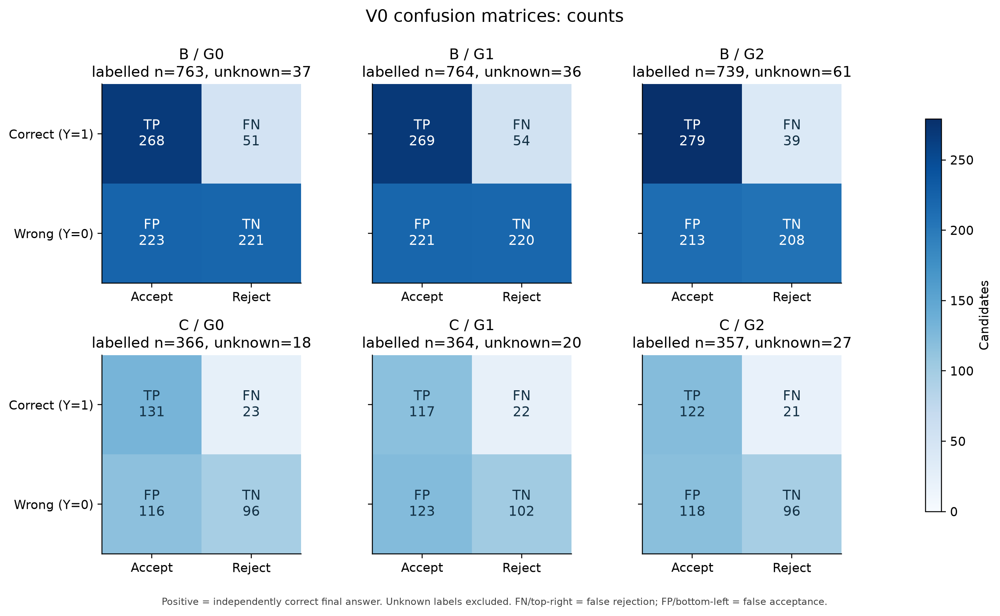
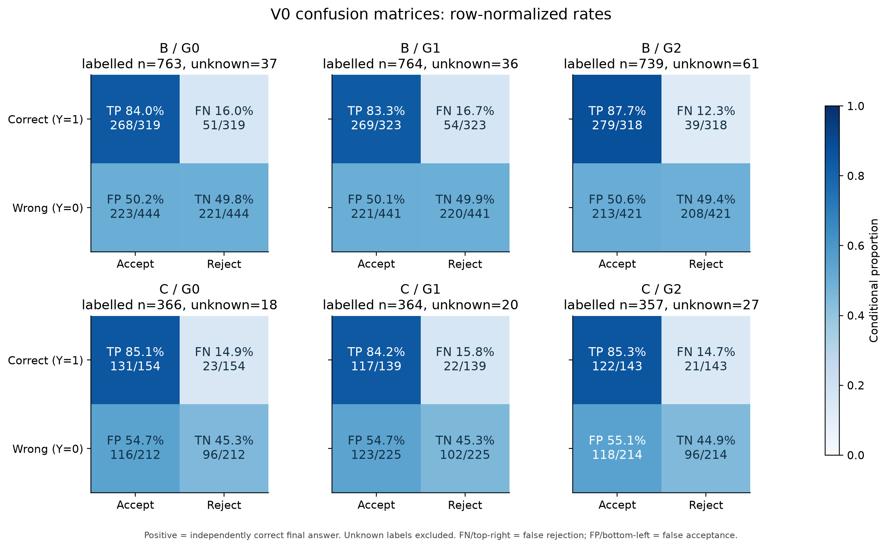
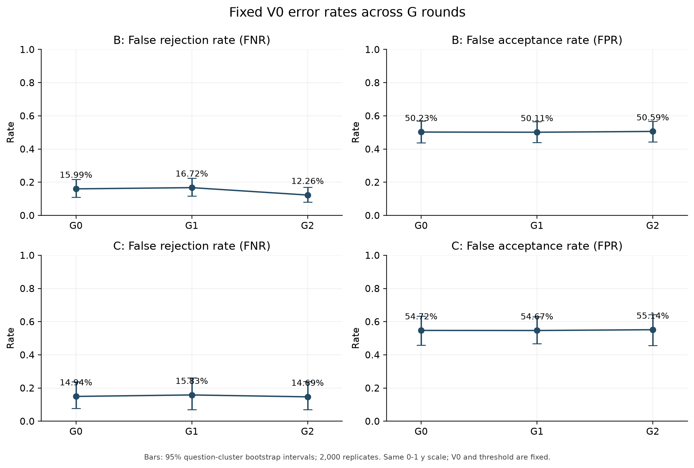
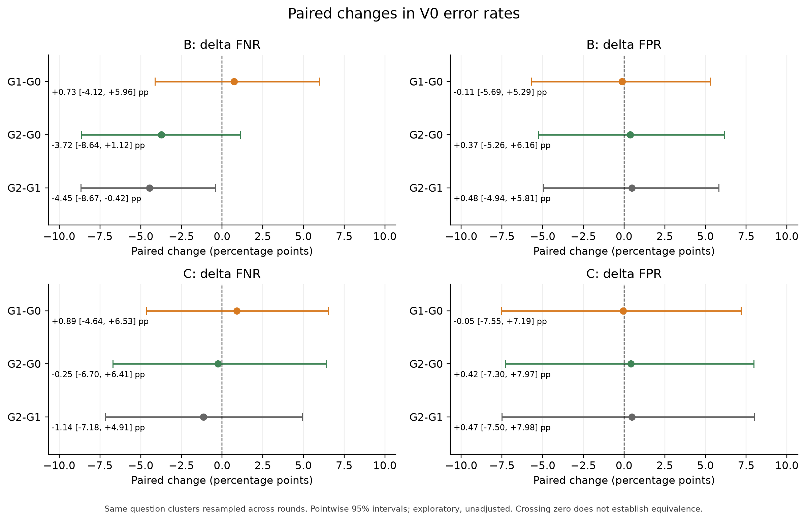
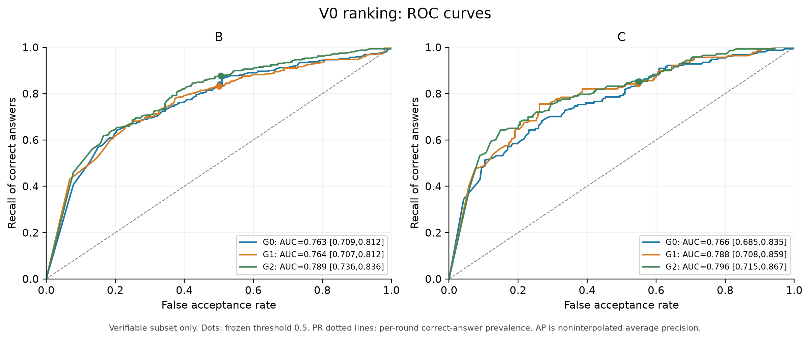
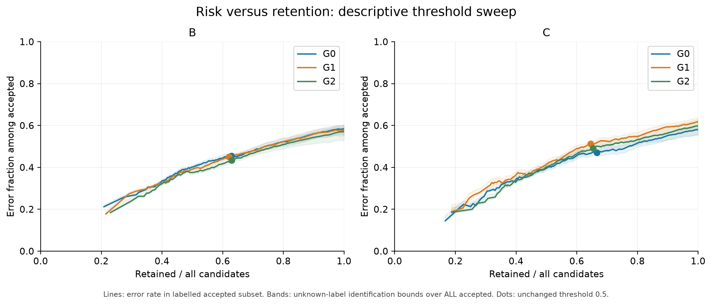
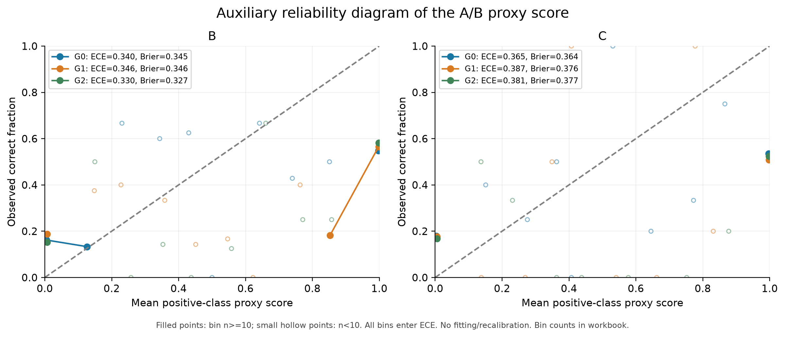
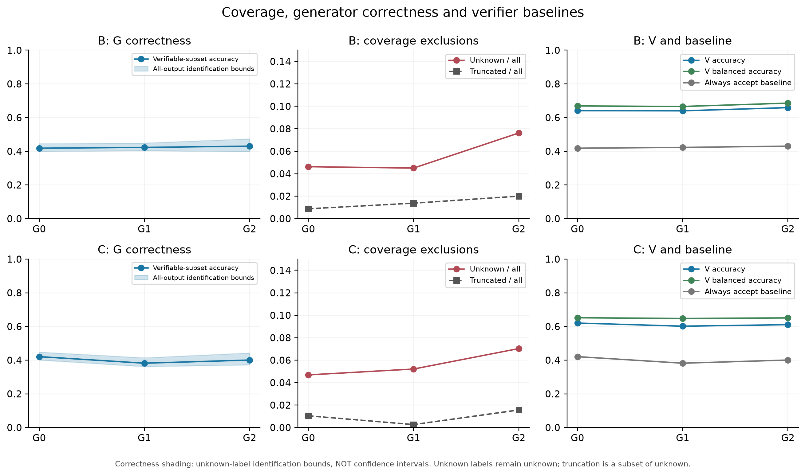
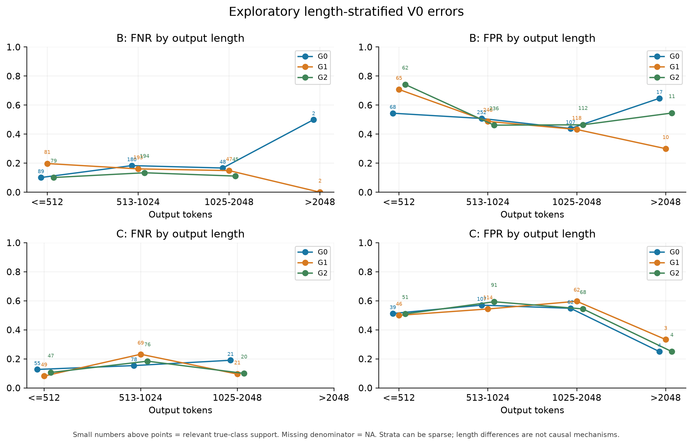
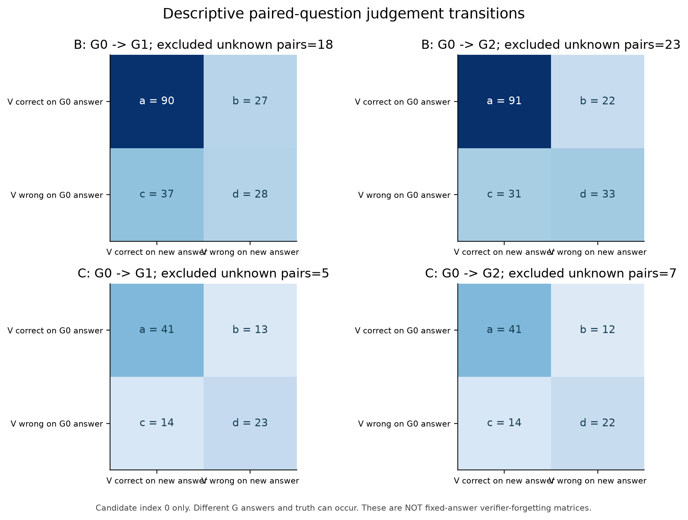

# 固定 V0 跨生成器轮次可靠性诊断（第一版）

**当前证据不支持“V0随G更新而明确、单向退化”的结论。** FPR约50%–55%，跨轮变化很小；B上G2的FNR较G0下降，但主要跨轮差值的95%区间仍跨0。更突出的事实是当前V0对自然错误的误接受偏高、实际SFT接受数据仍约一半错误。区间较宽，不能把未检出差异写成“已证明没有漂移”或“等价稳定”。

## 数据与固定协议

分析B200题、C96道有效题，每题每轮4候选，G0/G1/G2共3552条回答与同数V0评分。A只用于报告实际更新数据质量，不混入B/C判别成绩。C原100题中的4道坏题按题级排除；T保持封存。B是未来验证器更新池，C是开发池，本报告不称为最终独立测试。

标签来自冻结的最终答案核验规则，不依赖被测V0；未知不当作错误。V0权重、提示、条件A/B似然评分与0.5阈值不变。B/C已缓存回答逐条重算统计，TP/FN/FP/TN与正式报告一致；不新增推理、不训练、不改阈值。图中的V版本只有V0，不虚构Vrand/Vtarget成绩。

## 读图与指标定义

正类Y=1为“独立核验最终答案正确”；V接受为预测正。混淆矩阵行是真值正确/错误，列是V接受/拒绝。

| 指标 | 定义与解释 |
| --- | --- |
| 误拒率FNR | FN/(TP+FN)：正确回答中被V拒绝的比例 |
| 误接受率FPR | FP/(FP+TN)：错误回答中被V接受的比例 |
| 接受集错误率FDR | FP/(TP+FP)：有标签接受集中错误回答的比例，分母不同于FPR |
| 精确率PPV | TP/(TP+FP)：有标签接受集正确率=1-FDR |
| 召回/特异度 | TPR=1-FNR；TNR=1-FPR |
| 平衡准确率 | (TPR+TNR)/2；全部接受基线为0.5 |
| AUROC / AP | 排序区分能力；AP为阈值阶梯加权的平均精确率，不是PR曲线梯形面积 |
| F1 / MCC / NPV | 完整表中给出；MCC综合四个混淆计数，NPV为拒绝集内错误答案比例 |
| 保留率 | 接受数/全部候选数，包含未知；可核验子集保留率另列 |
| Brier/ECE10 | 把A/B归一化代理分数作二元正类分数的辅助校准诊断，不假设其已是可信概率 |

指标定义参照[scikit-learn模型评价文档](https://scikit-learn.org/stable/modules/model_evaluation.html)；分数校准与判别能力是不同对象，参见[概率校准文档](https://scikit-learn.org/stable/modules/calibration.html)与[Guo等，ICML 2017](https://proceedings.mlr.press/v70/guo17a.html)。本次未拟合校准器。

## 核心结果与95%区间

| 题池/轮次 | 可核验/未知 | FNR [95%区间] | FPR [95%区间] | 平衡准确率 | AUROC |
| --- | --- | --- | --- | --- | --- |
| B/G0 | 763/37 | 15.99% [10.97%, 21.73%] | 50.23% [43.70%, 56.90%] | 66.89% | 0.763 |
| B/G1 | 764/36 | 16.72% [11.71%, 22.51%] | 50.11% [43.92%, 56.48%] | 66.58% | 0.764 |
| B/G2 | 739/61 | 12.26% [8.01%, 17.01%] | 50.59% [44.30%, 56.75%] | 68.57% | 0.789 |
| C/G0 | 366/18 | 14.94% [7.80%, 23.72%] | 54.72% [45.85%, 63.40%] | 65.17% | 0.766 |
| C/G1 | 364/20 | 15.83% [7.03%, 26.21%] | 54.67% [46.70%, 62.93%] | 64.75% | 0.788 |
| C/G2 | 357/27 | 14.69% [7.05%, 23.97%] | 55.14% [45.58%, 64.19%] | 65.09% | 0.796 |

候选级指标按题聚类重采样2000次：每次抽取200个B题或96个C题，同题4候选一起进入，跨轮使用同一题目重采样索引。报告百分位95%点位区间；不是把所有候选当独立样本。区间仅反映本题池重采样不确定性，不包含重做G训练的随机性、参考答案错误和核验器系统误差。方法参见[bootstrap说明](https://docs.scipy.org/doc/scipy/reference/generated/scipy.stats.bootstrap.html)；本实现的重采样单位为整题。

## 相对G0的有符号漂移

ΔFNR=FNR(Gt)-FNR(G0)，ΔFPR同理；正数表示该项错误率升高，负数表示降低。这是V0面对不同G回答时的可靠性变化，既不是V0参数发生漂移，也不是输入分布距离。阈值没有逐轮重调。

| 题池 | 对比 | 指标 | 变化/百分点 | 成对95%区间/百分点 | 方向证据 |
| --- | --- | --- | --- | --- | --- |
| B | G1-G0 | FNR | +0.73 | [-4.12, +5.96] | 区间跨0 |
| B | G1-G0 | FPR | -0.11 | [-5.69, +5.29] | 区间跨0 |
| B | G2-G0 | FNR | -3.72 | [-8.64, +1.12] | 区间跨0 |
| B | G2-G0 | FPR | +0.37 | [-5.26, +6.16] | 区间跨0 |
| C | G1-G0 | FNR | +0.89 | [-4.64, +6.53] | 区间跨0 |
| C | G1-G0 | FPR | -0.05 | [-7.55, +7.19] | 区间跨0 |
| C | G2-G0 | FNR | -0.25 | [-6.70, +6.41] | 区间跨0 |
| C | G2-G0 | FPR | +0.42 | [-7.30, +7.97] | 区间跨0 |

这些是探索性、未做多重比较校正的区间；不据单个边缘结果宣布机制。区间跨0不等于证明相同，未预注册等价界值，因此不做等价性结论。G2-G1及其他指标差值见Excel/CSV。

补充观察：B上G2相对G1的FNR变化为-4.45个百分点，其探索性点位区间为[-8.67,-0.42]个百分点。这是相邻两轮的局部改善信号，未作多重比较校正，也不在C上重复出现；不能把它写成相对G0的确定改善或普遍跨轮规律。

## 接受池的实际风险

| 题池/轮次 | PPV正确率 | FDR错误率（有标签接受集） | 全候选保留率 | 接受集未知/总数 | 全部接受集风险识别界 |
| --- | --- | --- | --- | --- | --- |
| B/G0 | 54.58% | 45.42% | 62.88% | 12/503 | [44.33%, 46.72%] |
| B/G1 | 54.90% | 45.10% | 62.12% | 7/497 | [44.47%, 45.88%] |
| B/G2 | 56.71% | 43.29% | 63.00% | 12/504 | [42.26%, 44.64%] |
| C/G0 | 53.04% | 46.96% | 66.67% | 9/256 | [45.31%, 48.83%] |
| C/G1 | 48.75% | 51.25% | 64.58% | 8/248 | [49.60%, 52.82%] |
| C/G2 | 50.83% | 49.17% | 65.36% | 11/251 | [47.01%, 51.39%] |

风险识别界把接受集未知分别按全对/全错处理，不是抽样置信区间。FPR高表示错答案容易被放行，FDR还取决于正负样本组成；它们不能互相替代。ROC/PR与风险—保留率曲线仅描述冻结分数，不据本轮B/C真值改变实际训练筛选。

## 排序能力与分数校准

| 题池/轮次 | AUROC [95%区间] | AP | Brier代理分数误差 | ECE10代理分数误差 | 平均代理分数/实际正确率 |
| --- | --- | --- | --- | --- | --- |
| B/G0 | 0.763 [0.709, 0.812] | 0.688 | 0.345 | 0.340 | 0.648/0.418 |
| B/G1 | 0.764 [0.707, 0.812] | 0.703 | 0.346 | 0.346 | 0.643/0.423 |
| B/G2 | 0.789 [0.736, 0.836] | 0.721 | 0.327 | 0.330 | 0.664/0.430 |
| C/G0 | 0.766 [0.685, 0.835] | 0.711 | 0.364 | 0.365 | 0.670/0.421 |
| C/G1 | 0.788 [0.708, 0.859] | 0.694 | 0.376 | 0.387 | 0.656/0.382 |
| C/G2 | 0.796 [0.715, 0.867] | 0.715 | 0.377 | 0.381 | 0.674/0.401 |

AUROC点估计约0.76–0.80，表明V0分数对正负答案有一定排序区分力；但当前0.5工作点仍放行约一半的错误。平均正类代理分数明显高于真实正确比例，ECE10约0.33–0.39。排序能力、固定工作点的误接受、分数校准应分别解释，不能把例如0.99的A/B归一化分数直接解读成99%的答案正确概率。AUROC相对G0的成对区间也跨0，不能仅凭点估计上升声称排序能力显著增强。

## 覆盖、长度与基线敏感性

| 题池/轮次 | G正确率（可核验） | 完整输出正确率识别界 | 未知率 | 截断数 | 输出均长 | V总体准确率/全部接受基线 |
| --- | --- | --- | --- | --- | --- | --- |
| B/G0 | 41.81% | [39.88%, 44.50%] | 4.62% | 7 | 882.9 | 64.09%/41.81% |
| B/G1 | 42.28% | [40.38%, 44.88%] | 4.50% | 11 | 888.8 | 64.01%/42.28% |
| B/G2 | 43.03% | [39.75%, 47.38%] | 7.62% | 16 | 941.2 | 65.90%/43.03% |
| C/G0 | 42.08% | [40.10%, 44.79%] | 4.69% | 4 | 858.7 | 62.02%/42.08% |
| C/G1 | 38.19% | [36.20%, 41.41%] | 5.21% | 1 | 829.4 | 60.16%/38.19% |
| C/G2 | 40.06% | [37.24%, 44.27%] | 7.03% | 6 | 888.0 | 61.06%/40.06% |

B上可核验G正确率从41.81%到43.03%，但完整输出正确率下界从39.88%到39.75%，未知从37条增至61条。因此不能只据可核验子集百分比宣称G2能力提高。C的G正确率也没有单调上升。

B上G2相对G0的未知比例变化为+3.00个百分点，成对95%点位区间为[+0.62,+5.38]个百分点。覆盖变化值得单独关注；这也是为什么只比较已核验子集的正确率或FNR/FPR可能遗漏重要现象。该辅助比较同样未作多重校正。

作为额外敏感性检查，仅保留三个轮次全部4候选均可核验的共同题目，结果如下。该子集按核验完整性筛选，可能偏向易解析题，只作辅助，不能替代主样本。

| 题池/轮次 | 共同完整题数 | FNR | FPR |
| --- | --- | --- | --- |
| B/G0 | 135 | 11.40% | 54.10% |
| B/G1 | 135 | 13.92% | 56.55% |
| B/G2 | 135 | 9.89% | 55.06% |
| C/G0 | 68 | 13.18% | 58.74% |
| C/G1 | 68 | 13.91% | 61.78% |
| C/G2 | 68 | 14.41% | 59.09% |

例如C上全样本的G2-G0误拒率点差为-0.25个百分点，而共同完整题子集的点差约+1.23个百分点。方向会随分析子集改变，说明不能忽视标签覆盖与题目组成；这不是未知状态导致变化的因果证明。

按固定长度层≤512、513–1024、1025–2048、>2048报告类内错误率与分母。长回答层可能只有极少正确例，零分母记NA而不填0。现有DAPO记录缺少冻结题型/难度及独立解题错误类型标注，本次不事后发明这些分层，不按每轮是否答错定义难度。

## 描述性判断正确性转移

| 题池/对比 | a旧对新对 | b旧对新错 | c旧错新对 | d旧错新错 | 未知配对排除 | 保持/退化/修复 |
| --- | --- | --- | --- | --- | --- | --- |
| B/G1-G0 | 90 | 27 | 37 | 28 | 18 | 76.92%/23.08%/56.92% |
| B/G2-G0 | 91 | 22 | 31 | 33 | 23 | 80.53%/19.47%/48.44% |
| C/G1-G0 | 41 | 13 | 14 | 23 | 5 | 75.93%/24.07%/37.84% |
| C/G2-G0 | 41 | 12 | 14 | 22 | 7 | 77.36%/22.64%/38.89% |

按方案预定candidate_index=0、同题跨G配对。G回答和独立真值可能改变，上述“退化”只描述判断正确性从对到错，不能叫固定回答上的V遗忘。保持a/(a+b)、退化b/(a+b)、修复c/(c+d)，与数据保留率不同。目前Vrand/Vtarget尚未训练，因此不能交付它们在同批固定回答上的真实转移矩阵。

## 实际训练质量与解释范围

G1实际SFT入选500条：正确223、错误259、未知18；已核验错误率53.73%。独立标签仅在筛选落盘后统计，没有据真答案移除错例。

G2实际SFT入选501条：正确229、错误259、未知13；已核验错误率53.07%。独立标签仅在筛选落盘后统计，没有据真答案移除错例。

本轮只有同一G的一条两次小规模SFT轨迹，未证明生成器稳定增强，因此不能据此检验“强G使V更难验证”的一般性因果命题。现有结果支持的描述是：V0有一定正负区分力，但高误接受是持续问题；这次弱反馈更新带来的主要错误率差值尚不足以确证单向可靠性漂移。后续V更新、GRPO、理由和过程分析需独立执行，不从本报告外推。

## 文件索引

- `v0_drift_review.xlsx`：主指标、2000次区间、成对差值、长度层、逐题指标、候选摘要和60条抽查案例。
- `v0_drift_figures.pdf`：封面及15张完整图；`figures/`同时保存PNG、矢量PDF、SVG。
- `metrics_summary.csv` / `metrics_ci95.csv` / `paired_deltas.csv`：可直接继续统计的数值表。
- `metrics_and_inference.json`：完整指标、区间、转移与敏感性结果；`curves.json`：曲线数据。
- `candidates_full.jsonl`：3552条B/C候选完整原文、独立标签和V0评分；`review_cases.md`：可读抽查案例。
- `analysis_manifest.json`：分析参数、源文件哈希、实现哈希与原文件未更改的校验。

复现命令：`scripts/pilot v0_drift_analysis --bootstrap 2000 --seed 20261022`。本次仅CPU统计与绘图，T不读取/评价。

