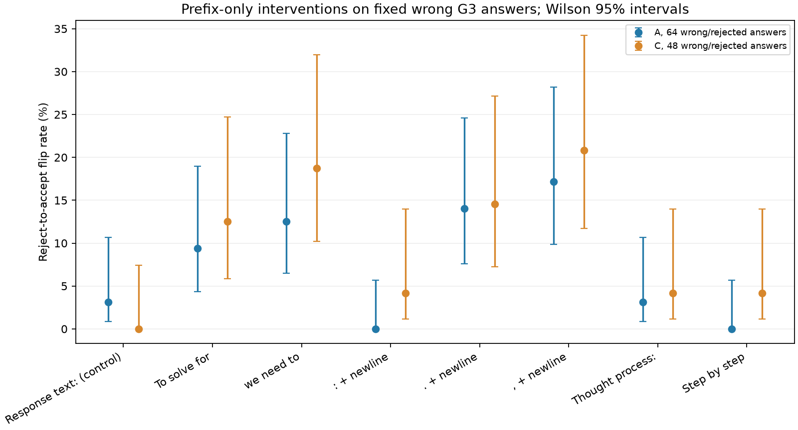
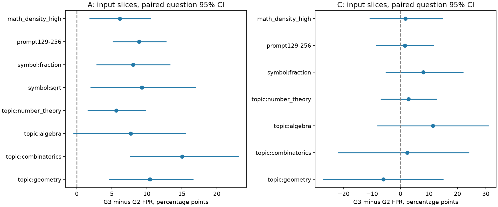
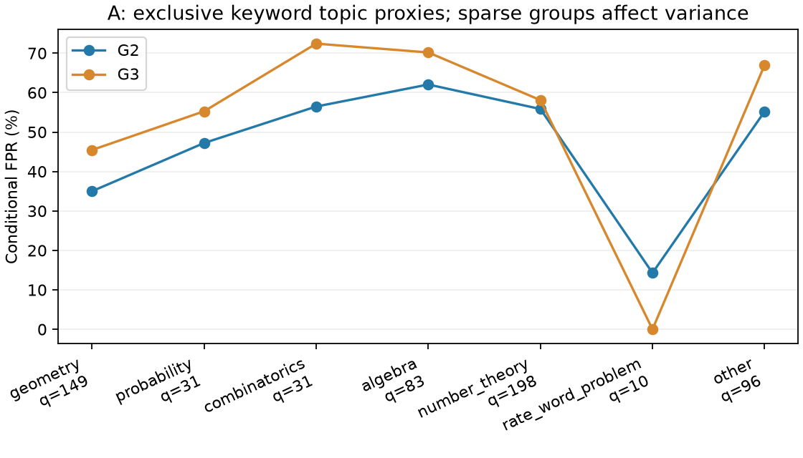

# G2→G3：EFP触发与SITE输入分层诊断

**检测到V0的可触发假阳性，但尚不能把A池FPR上涨归因于G3学会了某个万能触发词。输入分层显示A中多组风险上涨，未确认某一种题型独有的退化。**

## 范围与协议

按用户给出的工作定义，EFP=可触发的系统性假阳性，SITE=与输入绑定的系统性错误；这是本实验的操作化诊断，不声称复现某篇同名论文。EFP与SITE可能同时存在，不作二选一归因。

使用同引擎vLLM生成的G2/G3缓存：A598、C95，每题每轮4条，V0始终使用原参数、提示、Transformers A/B条件似然、0.5阈值，且完整看到回答。未知标签不当错误。原模型/缓存只读，B未使用，T未读取。A按题哈希分为发现与确认两份；触发片段只从发现份挖掘，干预样本来自不同A题或C。C已反复用于开发，不能称为最终独立测试。

原同引擎FPR：A 50.15%→57.84%（+7.69个百分点）；C 51.94%→54.59%（+2.65个百分点）。

## 1. EFP：只加前缀，错误答案能否从拒绝变成接受

在A确认份选64题、C选48题，每题1条原本被拒绝、最终答案经独立核验为错误且非截断的G3回答。比较原文、空白控制、中性描述前缀，以及9个候选前缀，共1344次V0评分。所有112条原文重新评分均复现拒绝；所有变体保留完整原文和同一错误最终答案，独立答案解析逐项核对通过。

候选包括4个在A发现份的G3假阳性中相对更常见的开场n-gram，以及用户指定的标点/通用开场白。句子片段可能不完整，按字面前缀测试，不冒充完整正确解答。下面每个前缀末尾都另有换行。

|前缀|A翻转/64|A翻转率|C翻转/48|C翻转率|
|---|---|---|---|---|
|`Response text:（控制）`|2|3.12%|0|0.00%|
|`To solve for`|6|9.38%|6|12.50%|
|`solve for the`|6|9.38%|5|10.42%|
|`To determine the probability`|3|4.69%|2|4.17%|
|`we need to`|8|12.50%|9|18.75%|
|`:`|0|0.00%|2|4.17%|
|`.`|9|14.06%|7|14.58%|
|`,`|11|17.19%|10|20.83%|
|`Thought process:`|2|3.12%|2|4.17%|
|`Let's solve this problem step by step.`|0|0.00%|2|4.17%|

原文与仅加换行两组均为0次翻转。逗号、句号和“we need to”在A/C均高于中性前缀；配对精确McNemar单侧检验，对9前缀×2题池共18次比较做BH校正后q<0.05。“To solve for”只在C高于控制（q=0.040），其余候选未通过该校正。这里只证明这些具体文本干预能改变被测样本的V判断，不代表它们适用于所有回答。

逗号翻转率的Wilson95%区间：A [9.88%,28.21%]，C [11.73%,34.26%]。翻转率的分母是原本被拒绝的错误回答，**不是全部错误回答，不能直接当作整体FPR增幅**。9项“A翻转率高于C”的单侧比较均无证据（BH q均为1），这也不证明两个题域完全相同。

### 能否解释G3自然FPR上涨

- 强效的“逗号/句号＋换行”开头，在原G2/G3的A错误回答中均未出现；人工可触发性不能直接解释自然轨迹。正文内部的标点频次另已导出，但没有验证任意位置/任意数量的标点效应。
- “we need to”在A错误回答的开场区域占比反而从22.35%降到20.26%；它可触发局部误接受，但不符合“G3学会更多使用它”的简单解释。
- “To solve for”确实从5.59%增到8.45%，但A注入相对中性前缀未通过校正（q=0.197）；未完成自然出现位置上的删除/替换干预，不能认定它驱动了+7.69个百分点。
- 补充的词语关联扫描控制了题目×轮次和回答长度，并按题聚类；多重比较与另半A/C确认后，未找到可稳健复现的特定关联词。高频词也可能只是题型、解法或样本构成的标记。

**EFP结论：存在可触发的格式脆弱性；“G3在A学会万能钥匙，造成A特有上涨”的归因尚未成立。**

## 2. SITE：输入条件下的FPR变化

按题面关键词、数学符号、固定prompt长度档、符号密度和标点分句代理分层。题型为透明关键词代理，可交叉归类，不是人工确认的数学题型；例如“square/cube”单独出现不判几何，以减少平方数误归类。分组规则和阈值使用题面确定。

|A输入组|题数|G2 FPR|G3 FPR|变化/百分点|按题配对95%区间/百分点|
|---|---|---|---|---|---|
|topic:geometry|149|35.00%|45.45%|+10.45|[+4.66,+16.57]|
|topic:combinatorics|51|48.98%|64.00%|+15.02|[+7.62,+23.06]|
|topic:number_theory|321|50.83%|56.47%|+5.64|[+1.57,+9.79]|
|topic:algebra|95|57.29%|64.97%|+7.68|[-0.45,+15.51]|
|symbol:sqrt|71|36.42%|45.71%|+9.30|[+2.00,+16.93]|
|symbol:fraction|144|42.25%|50.26%|+8.02|[+2.85,+13.30]|
|prompt129-256|347|45.75%|54.65%|+8.89|[+5.17,+12.72]|

几何、组合、数论、根号/分数及中等题长组的组内上升在BH校正后仍有信号。但所有输入组的“该组变化−其余题变化”交互检验均未通过BH校正；组合组的未经校正区间靠近0，不能据此筛出特异盲区。C对应分层没有通过校正的变化，样本较少。完整表同时列出错误分母、未知和截断，稀疏组不作显著性推断。积分/矩阵等实际支持数量也已列出，缺样本不解释成没有效应。

### 条件FPR方差

为避免交叉分组被重复计算，方差另用预定优先顺序形成互斥关键词类别。两轮固定同一组集合、同一权重；主要检查固定题数权重，同时保留各组等权结果。

|题池/权重|G2方差|G3方差|变化95%区间|
|---|---|---|---|
|A/unweighted|0.02392|0.05377|[+0.01064,+0.04405]|
|A/fixed_question_weights|0.01157|0.01401|[-0.00451,+0.00919]|
|C/unweighted|0.02956|0.03550|[-0.03567,+0.04190]|
|C/fixed_question_weights|0.02421|0.02733|[-0.03145,+0.03156]|

方差单位为比例的平方。A等权方差上升，但题数加权区间跨0。等权会让仅10题的应用题组与198题的数论组同权；该小组FPR从2/14降到0/12，也会把离散度拉大。方差增大不能直接读成各类题能力都恶化。部分重采样中某稀疏类没有错误分母，方差A有效9837/10000次、C9950/10000次，未定义项保留为未定义。

## 3. 哪些具体题值得追查

A两轮均有错误回答的400题中：133题FPR点估计上升，86题下降，181题不变；按“两轮各至少2条错误且FPR增幅至少50个百分点”的观察规则，A有51题、C有6题进入追查列表。另有A108题/C15题在两轮均保持至少75%误接受率，属于持续难以识别，而非新退化。

每题每轮最多4个错误候选，单题检验分辨率很低；A/C没有任何单题通过BH校正。观察名单和例子不能称为已确认的单题系统性退化。完整清单见`question_FPR_scan.csv`，定向初审见`case_reviews.md`。

例：中点正方形题8d2432ee…，正确答案10。G2/G3均有4条可核验错误，被接受的分别为0条和3条；所示两份都错答14，G3用“By symmetry”跳到错误坐标却得分1.0。数列题14b3d29c…的G3转移步骤更连贯，但忽略循环起点偏移，错答22仍被接受，正确答案为27。此类案例支持检查回答内容与组织变化，不能只凭开场词推断机制。

A整体+7.69个百分点可按题支持分解为：共同错误题的组成项+2.65、共同题内误接受变化项+5.52、新增错误题+1.29、退出错误题−1.76个百分点，四项相加恰为总变化。这是精确描述性分解，不是语义错误类型或因果分解。事后移除贡献最大的10题，A仍上升约6.02个百分点，说明点估计并非只由一两题驱动；这种移除只是敏感性检查。

**SITE结论：A里存在输入条件下的多组风险上涨和具体追查案例；尚不能确认某一题型特异性恶化，也不能把固定V参数未变时的条件风险变化说成V参数能力下降。EFP阴性/不足本身也不能证明SITE，反之亦然。**

## 审计与交付

EFP评分耗时235.6秒；无G生成、无训练、无V更新，GPU评分后已释放。原始缓存SHA256保持一致。软件检查138项通过；所有表格保留原始分母、区间、p/q和支持数量。

- `EFP_SITE_review.xlsx`：12个工作表，翻转、自然词频、输入分层、方差和逐题清单。
- `EFP_SITE_figures.pdf`：3页图；PNG可单独查看。
- `EFP_counterfactual_cases.jsonl`：112条完整原文及全部变体分数；实际前缀在冻结计划中。
- `case_reviews.md`：7个定向案例的精确检查与完整回答；助手初审，人工待审。
- `source/`、`configs/`及`artifact_manifest.json`：可复核代码、冻结计划和产物哈希。
- `EFP_SITE_review.zip`：本目录打包。
