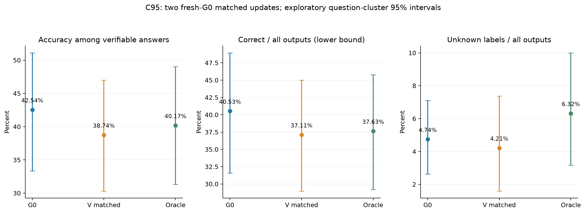
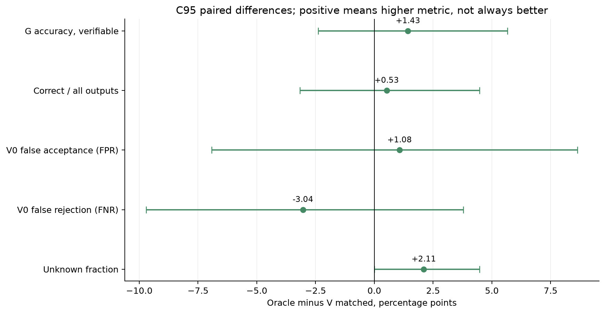
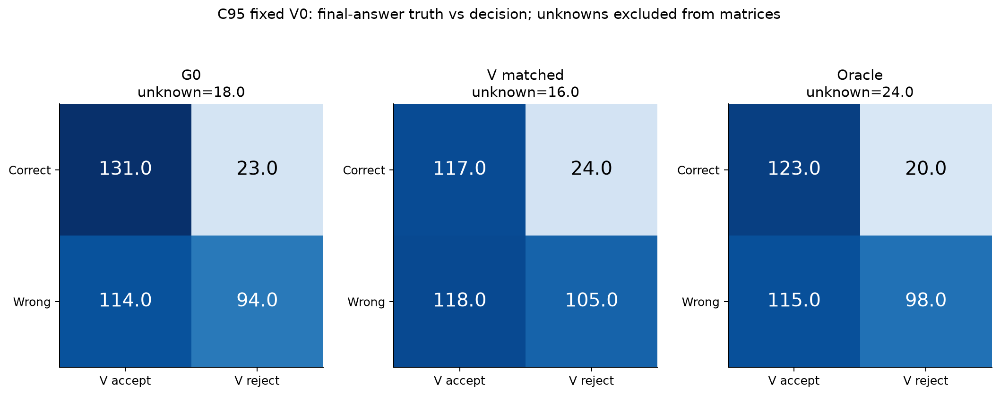

# 从G0出发的匹配oracle监督对照

**本次没有检出oracle分支相对匹配V分支的明确开发正确率优势；区间跨0。即使点估计有差异，也不足以在当前题池与单种子下区分“反馈质量限制”和“覆盖/更新预算限制”，更不能据此宣布SFT无效。**

研究问题：保持response-only SFT、题目覆盖及训练预算基本不变，提高最终答案监督的可靠性，能否获得更好的生成器更新？这是明确标记的oracle诊断，独立真值有意用于oracle筛选；不混入原无真值筛选主轨迹。

## 匹配做到了什么

| 项目 | Vmatched_SFT | Oracle_SFT |
| --- | --- | --- |
| 初始化 | 原始G0 + 新LoRA | 原始G0 + 新LoRA |
| 共同A题目 | 289，同一题单 | 289，同一题单 |
| 正确 / 错误 / 未知 | 223 / 63 / 3 | 289 / 0 / 0 |
| 可核验错误率 | 22.03% | 0.00% |
| 实际参与损失的回答token | 225,565 | 225,565 |
| 完整输入token | 264,654 | 264,654 |
| epoch / 优化器步 | 1 / 37 | 1 / 37 |
| microbatch / 梯度累积 | 1 / 8，末组1条 | 1 / 8，末组1条 |
| 学习率 / LoRA | 1e-4 / r16, alpha32, dropout0.05 | 相同 |
| 样本重复 / 截断 | 均无 | 均无 |

两组使用同一冻结trainer和AdamW实现（betas0.9/0.999，eps1e-8，weight_decay0.01，梯度裁剪1.0），同一题目顺序再用种子42打乱，因此每个梯度累积组的题目也相同。两组均不继承原G1/G2。实际末组只有1条，按实际组大小归一化，不把不足8条的梯度缩小。

独立审计精确重建578条训练张量，并逐步核对每条样本只消费一次、74个优化器步骤、实际token总量、G0初始化和adapter保存重载。原训练器曾用B题面做工程探针；本次通过隔离包装明确替换为独立固定文本“Compute 17 + 23.”，无B/C/T题面进入训练探针。冻结原源码未修改。

产物命名说明：为精确复用冻结优化逻辑，每个隔离分支内部仍叫G1阶段；它们不是原formal/G1。底层manifest继承原sample_selection文字及truth_input=False，后者指张量中没有单独参考答案字段，不能据此说oracle选样没用真值。实际选择以本study配置matching及各分支selection_semantics.json为准；Oracle的selected.jsonl明确selection_used_gold=true。原底层记录保留以便追溯。

## 题目选择及无法完全匹配的地方

A池原G0候选中，793条冻结独立标签正确，覆盖304道题。与原G1实际V选中500道题相交得289道；两组共同缩小到这一预算。Vmatched保留这些题原先实际选中的回答，不根据真值重选回答。Oracle在同题现有正确回答中选1条，先精确匹配总体监督token，再尽量减小逐题长度差。没有复制正确回答或补造样本。

两组有221条完整回答相同，68条不同。平均每题监督token绝对差70.6，最大2972；**总体token精确一致不代表逐题长度、过程质量和风格完全匹配**。

题集被条件化为“G0至少曾答对一次且原V路线实际选中过”，只覆盖A的48.17%，不代表完整600题。由于这一条件，匹配V分支的已核验错误率22.03%，明显低于旧500条分支的53.73%；这会降低两个新分支的噪声差异，也限制外推。旧G1的500条、414830监督token、63步只作历史背景，不能与289条oracle直接当作公平对照。

Oracle的“正确”仅指冻结独立最终答案核验通过，既不是全部过程正确的保证，也不是所有公开参考答案已获人工认证。Oracle目标仍是原G0完整回答，没有把参考解、修订答案或C/T材料插入训练。Vmatched的答案没有按真值筛选，但共同题单的确定使用了oracle可得性，这一条件明确披露。

## 相同开发评估协议

两组分别生成C原96道有效题、每题4候选，各384条。沿用原Transformers BF16 SDPA逐题采样函数、原题目种子、温度0.7/top_p0.9、同一提示和max_new_tokens=min(3840,4096−prompt_tokens)。V0原参数、提示、完整回答输入、A/B似然评分实现和0.5阈值全部不变。没有根据C表现改训练或阈值；G0相同协议下的原384条输出及V0评分直接复用。B未用于本对照，T继续封存。

前一轮发现C一题x³−y³=xy+61的源参考为6，而完整整数解给出的x之和是1。本报告以整题排除后的C95作为探索性主视图，并列原C96冻结标签及reference=1影子敏感性视图；不覆盖原标签或暗中修订主协议。未知保持未知，截断始终未知。

| C95 / 模型 | 正确 / 错误 / 未知 | G正确率（可核验） | 正确/全部输出 | 未知率 | V0 FPR | V0 FNR |
| --- | --- | --- | --- | --- | --- | --- |
| G0 | 154.0/208.0/18.0 | 42.54% | 40.53% | 4.74% | 54.81% | 14.94% |
| Vmatched_SFT | 141.0/223.0/16.0 | 38.74% | 37.11% | 4.21% | 52.91% | 17.02% |
| Oracle_SFT | 143.0/213.0/24.0 | 40.17% | 37.63% | 6.32% | 53.99% | 13.99% |

## 匹配分支的主要差值

| C95 / Oracle−Vmatched | 差值/百分点 | 成对95%区间/百分点 |
| --- | --- | --- |
| G可核验正确率 | +1.43 | [-2.39, +5.67] |
| 正确/全部输出 | +0.53 | [-3.16, +4.47] |
| 未知比例 | +2.11 | [+0.00, +4.47] |
| V0误接受率 | +1.08 | [-6.92, +8.64] |
| V0误拒率 | -3.04 | [-9.71, +3.78] |

每次重采样整道题，4候选一起进入，两模型和G0共用同一题目重采样索引；2000次百分位95%区间，种子20261022。这些是探索性点位区间，未作多重比较校正，也不含重新训练种子的随机性。未知不作为负标签；正确/全部输出是完整正确率下界，完整上界另在表中报告。

**本次没有检出oracle分支相对匹配V分支的明确开发正确率优势；区间跨0。即使点估计有差异，也不足以在当前题池与单种子下区分“反馈质量限制”和“覆盖/更新预算限制”，更不能据此宣布SFT无效。**

| C95 / 相对G0 | 可核验正确率变化/百分点 | 成对95%区间/百分点 |
| --- | --- | --- |
| Vmatched_SFT | -3.81 | [-8.29, +0.17] |
| Oracle_SFT | -2.37 | [-7.21, +2.31] |

## 原C96与参考修订敏感性

| 视图 | 模型 | 可核验G正确率 | 正确/全部输出 | 未知率 | FPR |
| --- | --- | --- | --- | --- | --- |
| C96_frozen_original | G0 | 42.08% | 40.10% | 4.69% | 54.72% |
| C96_frozen_original | Vmatched_SFT | 38.32% | 36.72% | 4.17% | 52.86% |
| C96_frozen_original | Oracle_SFT | 39.72% | 37.24% | 6.25% | 54.38% |
| C96_reference1_overlay | G0 | 42.35% | 40.36% | 4.69% | 54.50% |
| C96_reference1_overlay | Vmatched_SFT | 38.59% | 36.98% | 4.17% | 52.65% |
| C96_reference1_overlay | Oracle_SFT | 40.28% | 37.76% | 6.25% | 53.95% |

这些视图用于检查结论是否依赖一题参考或可核验分母，不挑选最有利的视图。完整计数、区间、保留率、接受集风险、AUROC及长度在Excel/CSV中给出。

## 如何解释这个对照

如果oracle在完整输出和可核验口径上均有一致改善，可把它视为本次预算下监督可靠性限制学习的证据；仍需复现。如果未改善，应继续检查共享题集是否过易或覆盖不足、37步/225565回答token的预算是否足够、正确最终答案下的过程质量，以及不同训练种子的变异。无论哪一种结果，都不能从这一条小规模轨迹直接推出SFT普遍有效或无效。

本对照保持题目、总体token及更新方法一致，但更换了部分完整回答，因此过程内容、局部长度和梯度方向同时会变化。它检验的是“改用更可靠的完整监督回答”这一实际干预，并未实现只更改单个正确性标签而保持所有监督文本不变的反事实。

## 运行资源与复现

单张RTX4090；两组训练合计161.4秒。开发生成单卡4个独立原采样进程、每分支2个，已有输出逐题落盘；训练和评估均由tmux后台执行。V0评分在完整生成后使用原实现。原正式结果与源码哈希保持一致。

本次评估开始前的vLLM镜像探测速度约0.25–0.45MiB/s，因此本对照保留原引擎。随后按用户指令另开后台备用环境任务，定位官方vLLM0.10.0+cu126（匹配Torch2.7.1+cu126）后，完整主包下载实际约3MiB/s，已按官方SHA256校验；其安装和GPU兼容状态见`reports/vllm_setup_20261022/`。备用准备不打断本轮评估，也不将vLLM输出混入本报告。预编译CUDA依赖兼容说明见[vLLM官方安装文档](https://docs.vllm.ai/en/v0.10.0/getting_started/installation/gpu.html)。

- `oracle_control_review.xlsx`：训练匹配、578条入选质量索引、主指标、区间、差值、逐步训练日志和1152条完整回答。

- `excel_export_notes.json`：题目原文中的Excel不支持控制字符仅在表格中显式转义为\uXXXX；完整JSONL和模型输入保持原样，未据此重写题目或重算结果。

- `oracle_control_figures.pdf` / `figures/`：5张图，PNG/PDF/SVG；`index.html`为浏览入口。

- `results.json`、`metrics.csv`、`metrics_ci95.csv`、`paired_deltas.csv`：完整数值。

- `training_audit.json`、`analysis_plan.json`、`validation.json`：张量审计、评估完成前固定的比较口径和最终验证。

- 训练配置：`configs/oracle_control_20261022.json`；运行与adapter：`runs/oracle_control_20261022/`；所有控制分支均与原formal目录隔离。

复现：`scripts/pilot oracle_control prepare`、`scripts/pilot oracle_control train --arm Vmatched_SFT`、`scripts/pilot oracle_control train --arm Oracle_SFT`、`scripts/pilot oracle_evaluate run`。已完成训练/输出会使用缓存，不重复消费预算。

实验计算日期：北京时间2026-10-22。2026-10-24修复Excel显示层控制字符转义并补齐导出、验证和打包；训练、生成、V0评分及results.json统计均未重跑或改写。原始产物UTC时间保留。
