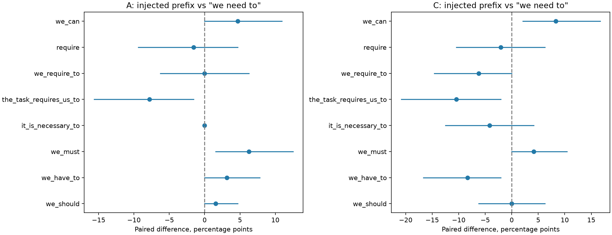
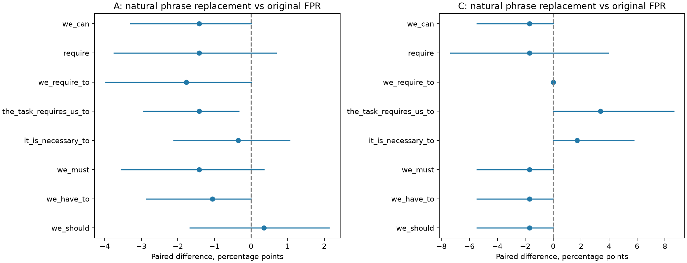

# 前缀近义改写与句式替换实验

A自然错误组：原文FPR为48.41%；改写为we should 48.76%，we have to 47.35%，require 47.00%。
C自然错误组：原文FPR为38.98%；改写为we should 37.29%，we have to 37.29%，require 37.29%。

以下把人工注入和自然原位替换分别比较。数值差异、配对区间和多重校正结果一起看；某些句式改变语气或语法，不只改变字面词形。

固定V0参数、提示、原Transformers A/B似然评分及0.5阈值。无G生成、无训练、B未使用、T未读取。全部变体在新评分前冻结，保留全部结果。

## 两个不同问题

注入组：沿用此前112道题各1条原本被拒绝的错误G3回答（A确认份64、C48），把人工注入的独立前缀替换为46种词语、语气、句式、格式或控制条件。回答全文不变。这里的接受率是“原本被拒错误回答的翻转率”，不是整池FPR。

自然组：G3全部自然命中we need to开场区域的498条回答（A410、C88）；只在原位置替换第一处短语，10种处理，含原文、删除、近义和语法压力表达。A含87正确/283错误/40未知，C含23正确/59错误/6未知；未知不并入错误。多候选同题依赖按题聚类处理。C为已反复使用的开发集，不是封存的最终T。

`we should`、`we can`改变模态强度；`require`、`we require to`允许语法不自然。本实验称“词形/模态/句式改写”，不把所有变体都当作完全语义等价的近义词。所有变体独立核对最终答案、真假标签、解析状态不变，完整数学后缀保持字节一致。

## 1. 同一批错误回答：换注入前缀后的翻转率

|前缀|A接受率|相对we need to/百分点|C接受率|相对we need to/百分点|
|---|---|---|---|---|
|we need to|12.50%|+0.00|18.75%|+0.00|
|we should|14.06%|+1.56|18.75%|+0.00|
|we have to|15.62%|+3.12|10.42%|-8.33|
|we must|18.75%|+6.25|22.92%|+4.17|
|it is necessary to|12.50%|+0.00|14.58%|-4.17|
|the task requires us to|4.69%|-7.81|8.33%|-10.42|
|we require to|12.50%|+0.00|12.50%|-6.25|
|require|10.94%|-1.56|16.67%|-2.08|
|we can|17.19%|+4.69|27.08%|+8.33|

46种完整结果见`prefix_paired_results.csv`，含大小写、标点、空格、To solve for同族和推理标题。每个前缀末尾的换行也属于干预；不得把不同位置/格式当作同一个词的普遍效果。完整图为`all_prefix_flip_rates.png`。

主比较为相对we need to的双侧精确McNemar检验，跨所有非参照变体×A/C作BH校正；相对中性前缀另列一族。按题配对bootstrap10000次、seed20261024。探索性区间未作同时覆盖校正，少数翻转时也不等同于精确检验的反演区间；显著性以预定p/q判断。比较族比上次9前缀实验更大且此次为双侧检验，q值不能与上次直接对照。筛出的最大效果也不代表预先知道最优表达。

## 2. 自然出现的短语：原位替换后FPR

|改写|A错误回答FPR|A变化/百分点|A配对95%区间/百分点|C错误回答FPR|C变化/百分点|
|---|---|---|---|---|---|
|we need to（原文）|48.41%|+0.00|[+0.00,+0.00]|38.98%|+0.00|
|we should|48.76%|+0.35|[-1.67,+2.13]|37.29%|-1.69|
|we have to|47.35%|-1.06|[-2.86,+0.00]|37.29%|-1.69|
|we must|47.00%|-1.41|[-3.55,+0.35]|37.29%|-1.69|
|it is necessary to|48.06%|-0.35|[-2.11,+1.05]|40.68%|+1.69|
|the task requires us to|47.00%|-1.41|[-2.93,-0.33]|42.37%|+3.39|
|we require to|46.64%|-1.77|[-3.97,+0.00]|38.98%|+0.00|
|require|47.00%|-1.41|[-3.75,+0.68]|37.29%|-1.69|
|we can|47.00%|-1.41|[-3.30,+0.00]|37.29%|-1.69|
|删除该短语|47.35%|-1.06|[-3.05,+0.66]|37.29%|-1.69|

自然组对每种处理以同一回答原文为对照，错误回答看FPR、正确回答看FNR，未知只描述接受率。标准误和bootstrap按题聚类；FPR的9处理×2题池共18项作BH校正，FNR另作一族。C某些标签组独立题数较少，完整表标记支持量。

- A自然错误组：通过BH校正的变体为无。
- C自然错误组：通过BH校正的变体为无。

### 同一条错误回答的双向变化

|题池/处理|原误接受→拒绝|原拒绝→误接受|净新增误接受|
|---|---|---|---|
|A/we should|2|3|+1|
|A/we have to|3|0|-3|
|A/require|6|2|-4|
|C/we should|1|0|-1|
|C/we have to|1|0|-1|
|C/require|2|1|-1|

总体变化小也可能包含双向翻转；不能仅凭净FPR稳定，就认为同一回答对词形改写不敏感。

## 3. 改写全部自然命中后，G3整池指标

这不是抽样外推：已覆盖全部498条自然命中回答，未命中者复用原判定。这里只计算当前G3缓存经该编辑后的完整题池指标；尚未对G2做相同编辑，不能解释为G2→G3训练差值的因果贡献。

|题池/处理|整池FPR|整池FPR变化/百分点|整池FNR|整池FNR变化/百分点|
|---|---|---|---|---|
|A/we need to（原文）|57.84%|+0.00|7.75%|+0.00|
|A/we should|57.91%|+0.07|7.87%|+0.12|
|A/we have to|57.62%|-0.21|7.87%|+0.12|
|A/require|57.55%|-0.29|7.99%|+0.24|
|A/删除该短语|57.62%|-0.21|7.99%|+0.24|
|C/we need to（原文）|54.59%|+0.00|14.29%|+0.00|
|C/we should|54.13%|-0.46|14.29%|+0.00|
|C/we have to|54.13%|-0.46|14.29%|+0.00|
|C/require|54.13%|-0.46|14.97%|+0.68|
|C/删除该短语|54.13%|-0.46|14.97%|+0.68|

正确回答的FNR结果必须同时看：若某种改写使V整体更倾向拒绝，FPR下降不自动说明验证能力改善。单独前缀注入组与自然原位组的样本、位置和上下文不同，不能只凭两组效果差异认定位置是唯一原因。

## 审计与复核

每条原文均重新评分并核对历史分数与判定；只有完整输入完全相同的既有注入变体才复用旧分数。评分均未截断。`scores`总调用条目不等于独立题数；自然组同题多个候选始终一起重采样。

`paraphrase_review.xlsx`包含完整比较、总体指标和变体清单；`paraphrase_figures.pdf`为4页图（含完整46种前缀及正确回答FNR）；`changed_cases.md`与JSONL保留定向变化案例；原文、跨度及每次评分分别保留在runs/prefix_paraphrase_20261024。新发现的强变体属于本次探索，不自动泛化为万能钥匙或G已学会利用它。
