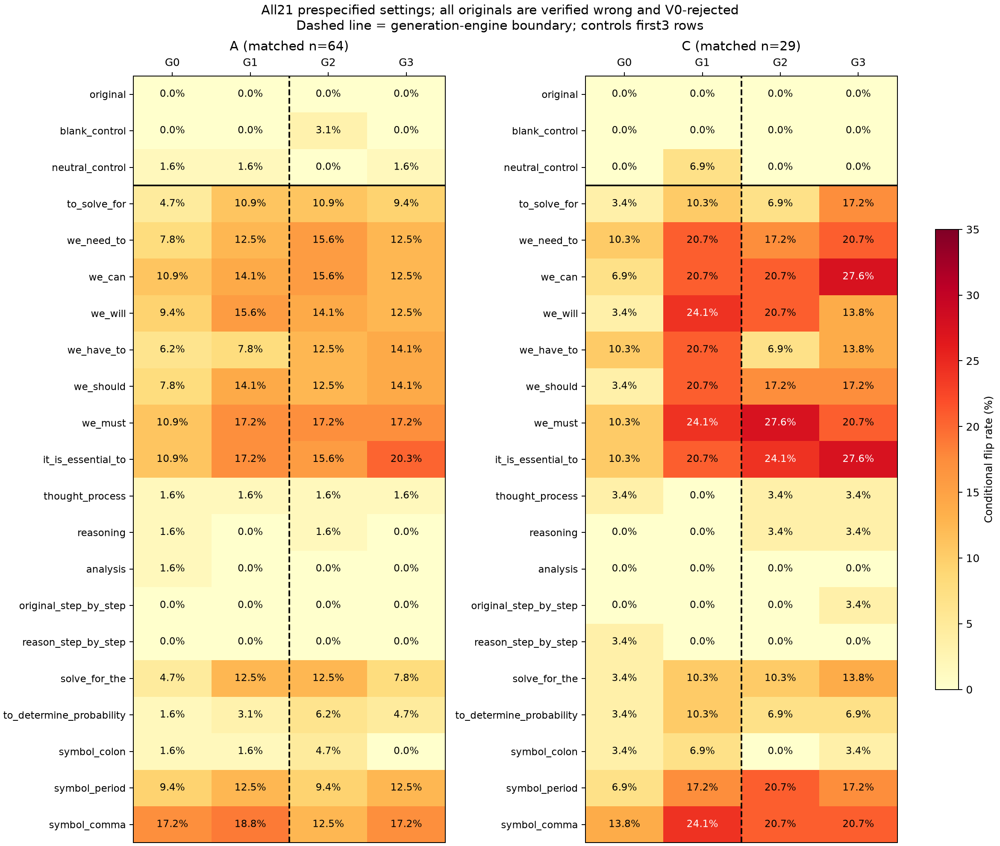

# 前缀实验统一入口：同一前缀在G0—G3上的结果

四阶段同前缀测试已于2026-10-25完成并已有独立报告；本目录仅统一已有表格和连续分数，不新增生成、V评分或训练，不改写旧实验及其归档。

固定V0。A为同64题，C为同29题；每题在每个G阶段选1条已知错误、未截断且原V0拒绝的回答，共372条，均测试相同21设置（18前缀+3控制）。下表为TN→FP条件翻转率：原本拒绝的错误回答注入后被接受的比例，不是全池FPR。四阶段没有正确回答的对应注入轨迹；G3正确回答FNR另表保存，不能填成四阶段FNR。

G0/G1原文由Transformers生成，G2/G3由vLLM生成；V始终用同一Transformers评分。G1→G2存在生成引擎断点；同引擎G2→G3的36项前缀/题池比较均未通过BH校正。

## A池：同64道题，所有前缀的四阶段结果

前缀列使用JSON字面量，`\n`表示真实换行；大小写、标点和空格均属于干预。

| 实际前缀字符串 | G0 | G1 | G2 | G3 |
| --- | --- | --- | --- | --- |
| `""` | 0/64 (0.00%) | 0/64 (0.00%) | 0/64 (0.00%) | 0/64 (0.00%) |
| `"\n"` | 0/64 (0.00%) | 0/64 (0.00%) | 2/64 (3.12%) | 0/64 (0.00%) |
| `"Response text:\n"` | 1/64 (1.56%) | 1/64 (1.56%) | 0/64 (0.00%) | 1/64 (1.56%) |
| `"To solve for\n"` | 3/64 (4.69%) | 7/64 (10.94%) | 7/64 (10.94%) | 6/64 (9.38%) |
| `"we need to\n"` | 5/64 (7.81%) | 8/64 (12.50%) | 10/64 (15.62%) | 8/64 (12.50%) |
| `"we can\n"` | 7/64 (10.94%) | 9/64 (14.06%) | 10/64 (15.62%) | 8/64 (12.50%) |
| `"we will\n"` | 6/64 (9.38%) | 10/64 (15.62%) | 9/64 (14.06%) | 8/64 (12.50%) |
| `"we have to\n"` | 4/64 (6.25%) | 5/64 (7.81%) | 8/64 (12.50%) | 9/64 (14.06%) |
| `"we should\n"` | 5/64 (7.81%) | 9/64 (14.06%) | 8/64 (12.50%) | 9/64 (14.06%) |
| `"we must\n"` | 7/64 (10.94%) | 11/64 (17.19%) | 11/64 (17.19%) | 11/64 (17.19%) |
| `"it is essential to\n"` | 7/64 (10.94%) | 11/64 (17.19%) | 10/64 (15.62%) | 13/64 (20.31%) |
| `"Thought process:\n"` | 1/64 (1.56%) | 1/64 (1.56%) | 1/64 (1.56%) | 1/64 (1.56%) |
| `"Reasoning:\n"` | 1/64 (1.56%) | 0/64 (0.00%) | 1/64 (1.56%) | 0/64 (0.00%) |
| `"Analysis:\n"` | 1/64 (1.56%) | 0/64 (0.00%) | 0/64 (0.00%) | 0/64 (0.00%) |
| `"Let's solve this problem step by step.\n"` | 0/64 (0.00%) | 0/64 (0.00%) | 0/64 (0.00%) | 0/64 (0.00%) |
| `"Let's reason step by step.\n"` | 0/64 (0.00%) | 0/64 (0.00%) | 0/64 (0.00%) | 0/64 (0.00%) |
| `"solve for the\n"` | 3/64 (4.69%) | 8/64 (12.50%) | 8/64 (12.50%) | 5/64 (7.81%) |
| `"To determine the probability\n"` | 1/64 (1.56%) | 2/64 (3.12%) | 4/64 (6.25%) | 3/64 (4.69%) |
| `":\n"` | 1/64 (1.56%) | 1/64 (1.56%) | 3/64 (4.69%) | 0/64 (0.00%) |
| `".\n"` | 6/64 (9.38%) | 8/64 (12.50%) | 6/64 (9.38%) | 8/64 (12.50%) |
| `",\n"` | 11/64 (17.19%) | 12/64 (18.75%) | 8/64 (12.50%) | 11/64 (17.19%) |

## C池：同29道题，所有前缀的四阶段结果

前缀列使用JSON字面量，`\n`表示真实换行；大小写、标点和空格均属于干预。

| 实际前缀字符串 | G0 | G1 | G2 | G3 |
| --- | --- | --- | --- | --- |
| `""` | 0/29 (0.00%) | 0/29 (0.00%) | 0/29 (0.00%) | 0/29 (0.00%) |
| `"\n"` | 0/29 (0.00%) | 0/29 (0.00%) | 0/29 (0.00%) | 0/29 (0.00%) |
| `"Response text:\n"` | 0/29 (0.00%) | 2/29 (6.90%) | 0/29 (0.00%) | 0/29 (0.00%) |
| `"To solve for\n"` | 1/29 (3.45%) | 3/29 (10.34%) | 2/29 (6.90%) | 5/29 (17.24%) |
| `"we need to\n"` | 3/29 (10.34%) | 6/29 (20.69%) | 5/29 (17.24%) | 6/29 (20.69%) |
| `"we can\n"` | 2/29 (6.90%) | 6/29 (20.69%) | 6/29 (20.69%) | 8/29 (27.59%) |
| `"we will\n"` | 1/29 (3.45%) | 7/29 (24.14%) | 6/29 (20.69%) | 4/29 (13.79%) |
| `"we have to\n"` | 3/29 (10.34%) | 6/29 (20.69%) | 2/29 (6.90%) | 4/29 (13.79%) |
| `"we should\n"` | 1/29 (3.45%) | 6/29 (20.69%) | 5/29 (17.24%) | 5/29 (17.24%) |
| `"we must\n"` | 3/29 (10.34%) | 7/29 (24.14%) | 8/29 (27.59%) | 6/29 (20.69%) |
| `"it is essential to\n"` | 3/29 (10.34%) | 6/29 (20.69%) | 7/29 (24.14%) | 8/29 (27.59%) |
| `"Thought process:\n"` | 1/29 (3.45%) | 0/29 (0.00%) | 1/29 (3.45%) | 1/29 (3.45%) |
| `"Reasoning:\n"` | 0/29 (0.00%) | 0/29 (0.00%) | 1/29 (3.45%) | 1/29 (3.45%) |
| `"Analysis:\n"` | 0/29 (0.00%) | 0/29 (0.00%) | 0/29 (0.00%) | 0/29 (0.00%) |
| `"Let's solve this problem step by step.\n"` | 0/29 (0.00%) | 0/29 (0.00%) | 0/29 (0.00%) | 1/29 (3.45%) |
| `"Let's reason step by step.\n"` | 1/29 (3.45%) | 0/29 (0.00%) | 0/29 (0.00%) | 0/29 (0.00%) |
| `"solve for the\n"` | 1/29 (3.45%) | 3/29 (10.34%) | 3/29 (10.34%) | 4/29 (13.79%) |
| `"To determine the probability\n"` | 1/29 (3.45%) | 3/29 (10.34%) | 2/29 (6.90%) | 2/29 (6.90%) |
| `":\n"` | 1/29 (3.45%) | 2/29 (6.90%) | 0/29 (0.00%) | 1/29 (3.45%) |
| `".\n"` | 2/29 (6.90%) | 5/29 (17.24%) | 6/29 (20.69%) | 5/29 (17.24%) |
| `",\n"` | 4/29 (13.79%) | 7/29 (24.14%) | 6/29 (20.69%) | 6/29 (20.69%) |

## 跨阶段可作出的判断

| 题池 | G0 | G1 | G2 | G3 |
| --- | --- | --- | --- | --- |
| A | 5.99% | 8.85% | 9.03% | 8.68% |
| C | 5.36% | 12.84% | 11.49% | 12.84% |

此为18个非控制前缀等权的探索性均值，不是“至少一个前缀成功”的回答比例。A的G3−G2为−0.35个百分点，按题配对95%区间[−6.25,+5.73]；C为+1.34，[−9.58,+12.84]。已有局部前缀敏感性证据，但不支持“越到后期所有前缀越容易使V翻转”的一致单调规律。

自然输出的跨轮FPR、注入后的TN翻转率、正确回答上的FNR是三个不同量。也不能将本表G3与最初A64/C48的G3表直接连成时间趋势：本表要求四阶段共同TN题，选样不同。原文组全0来自原TN选样，并不表示全池原FPR为0。

## 连续评分与完整记录

[统一Excel](prefix_results_overview.xlsx)含8表：同前缀四阶段、连续分数汇总、7812条原始/干预评分、旧成对区间、前缀均值、G3正确回答FNR、实际前缀和实验索引。

[模板与前缀](V0_template_and_prefixes.json)保留完整system/user模板、原tokenizer聊天模板及前缀token IDs。逐条分数保留原始/干预score、两类log likelihood及其差、正确性、原文/变体提示token数和实际新增token数；[372条完整回答](answers_full.jsonl)通过candidate_id连接。分数不是校准概率；饱和分数的细微变化另看LL_A−LL_B。

本汇总没有补齐“约100题×每题4回答、不按原V判定选样”的新面板，不能将现有条件样本冒充该面板。按本次安排不为此新增评分。

## 其余已完成实验，统一从这里查

| 实验 | 覆盖与作用 | 原报告 |
| --- | --- | --- |
| 四阶段同前缀 | A64+C29，同题四G，各1条原TN；21设置 | [查看](../cross_round_prefix_20261025/cross_round_prefix_report.md) |
| 最初EFP注入 | G3 A64+C48，各1条原TN；12设置 | [查看](../fpr_patterns_20261024/EFP_SITE_report.md) |
| 广泛前缀及自然近义替换 | G3原TN112条×46；自然命中498条×10 | [查看](../prefix_paraphrase_20261024/paraphrase_report.md) |
| G3正确回答FNR | A839+C147全部已知正确，21设置 | [查看](../prefix_fnr_20261025/prefix_FNR_report.md) |
| 自然TP/TN删除替换 | 741条原判对且自然命中回答；3设置 | [查看](../natural_invariance_20261024/natural_invariance_report.md) |
| AWL词表内外 | G3原TN112条，20对词及控制 | [查看](../awl_comparison_20261024/AWL_comparison_report.md) |
| 长度关联 | 复用旧前缀分数，未新增评分 | [查看](../prefix_length_20261025/prefix_length_report.md) |
| 自然表达训练链及对称编辑 | 训练选样链、G2/G3自然删除/替换、答案改错对照 | [查看](../closing_diagnostics_20261025/supplementary_evidence_report.md) |

## 已有图表

[四阶段三页图](../cross_round_prefix_20261025/cross_round_prefix_figures.pdf) · [完整四阶段原报告](../cross_round_prefix_20261025/cross_round_prefix_report.md) · [G3正确回答FNR图](../prefix_fnr_20261025/prefix_FNR_figures.pdf)

