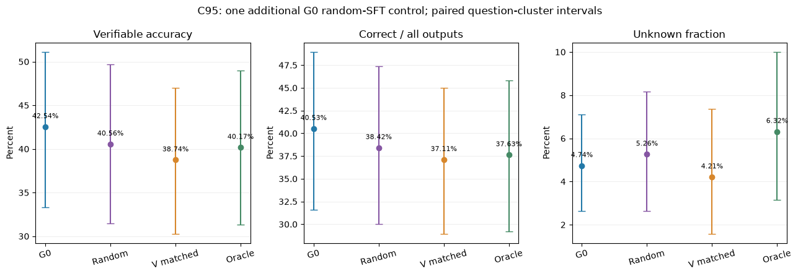
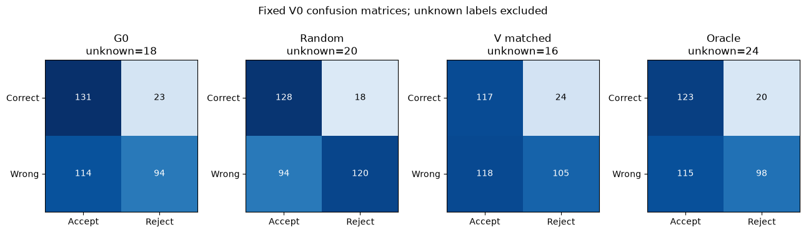

# 随机选样SFT补充对照

本轮仅新增Random_SFT。原G0、Vmatched_SFT、Oracle_SFT直接复用已缓存C输出；不重训、不改标签、不改变V0。

## 固定设计与选样边界

三条SFT分支均从原始G0开始，同一批289道A题、每题一条完整回答、1 epoch、37步；学习率1e-4、LoRA r16/alpha32/dropout0.05、训练种子42及原优化实现一致。

随机组候选来自已有G0_A，每题均匀随机抽一条；只对整批回答loss token总量做±0.5%长度条件接受，选择第一个合格组合。种子20261024，最多100000次；失败则保留第一次均匀抽样，明确报告预算不匹配。选样不读取V分数或正确性标签，标签仅在selected/tensors哈希提交之后关联作质量记录。

本次抽样次数19；回答监督token为224951，目标225565，相差-0.272%。长度匹配是否通过：True。

**随机性限制：这是给定总体长度预算的条件随机抽样，不是无条件逐题均匀抽样。**同一题单此前已条件化为“G0至少有一个正确候选且原V路线选中过”，不能将本对照外推到全部A，也不能称为完全不涉及真值的题目抽样。回答选择本身不使用真值。

不同回答的逐题长度和过程内容仍可能不同；总体token匹配不等于梯度方向或每题监督长度相同。完整正确标签仍不保证全过程正确。独立探针Compute 17 + 23.，没有B/C/T进入训练。

## 实际训练数据

| 模型 | 正确/错误/未知 | 回答loss token | 优化器步 |
| --- | --- | --- | --- |
| Random_SFT | 198/80/11 | 224951 | 37 |
| Vmatched_SFT | 223/63/3 | 225565 | 37 |
| Oracle_SFT | 289/0/0 | 225565 | 37 |

## C95开发结果

沿用原Transformers BF16采样器、相同题目种子和每题4候选、上下文4096/max_new≤3840。V0参数/提示/A-B似然评分及0.5阈值固定；不以vLLM替换研究引擎。C95排除既有参考疑点整题，另列原C96和reference=1影子视图，未知不当作错误。

| 模型 | 正确/错误/未知 | 可核验正确率 | 正确/全部 | 未知率 | V0 FPR | V0 FNR |
| --- | --- | --- | --- | --- | --- | --- |
| G0 | 154/208/18 | 42.54% | 40.53% | 4.74% | 54.81% | 14.94% |
| Random_SFT | 146/214/20 | 40.56% | 38.42% | 5.26% | 43.93% | 12.33% |
| Vmatched_SFT | 141/223/16 | 38.74% | 37.11% | 4.21% | 52.91% | 17.02% |
| Oracle_SFT | 143/213/24 | 40.17% | 37.63% | 6.32% | 53.99% | 13.99% |

## 相对随机组与G0的差值

| 比较 | 可核验正确率差/百分点 | 成对95%区间/百分点 |
| --- | --- | --- |
| Random_SFT-G0 | -1.99 | [-5.59, +1.70] |
| Vmatched_SFT-Random_SFT | -1.82 | [-6.13, +2.29] |
| Oracle_SFT-Random_SFT | -0.39 | [-4.75, +3.96] |
| Vmatched_SFT-G0 | -3.81 | [-8.29, +0.17] |
| Oracle_SFT-G0 | -2.37 | [-7.21, +2.31] |

区间按整题配对重采样2000次，四候选共同进入；探索性点位95%区间、未做多重比较校正，也不包含重新训练种子的变异。C已经用于前序诊断，本轮没有使用独立新测试集，因此不能作最终测试结论。

随机SFT与G0比较反映本次无质量筛选更新的结果；V/Oracle与随机组的差值用于检查筛选的增量作用。若区间跨0，不解释为等效或证明筛选无用；若点估计改善，也不归结为唯一因果机制。

## 完整性与资源

289条训练张量精确重建、随机抽样独立复现、37步与题目顺序核对通过；384条新生成及384条完整V0评分逐记录审计通过。训练70.0秒，峰值显存9.68GiB。生成单4090、4个原采样进程，tmux可恢复。T继续封存。

原正式和Oracle产物哈希保持一致。运行目录runs/random_control_20261024；完整原文candidates_full.jsonl（1536条），实际随机训练质量training_quality_audit.jsonl在运行目录。Excel仅显示层转义XML不支持字符，原文与模型输入不改写。

报告完成UTC时间：2026-10-24T07:32:30.726553+00:00。