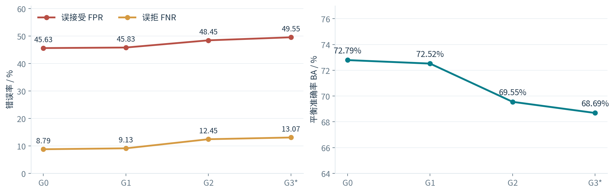
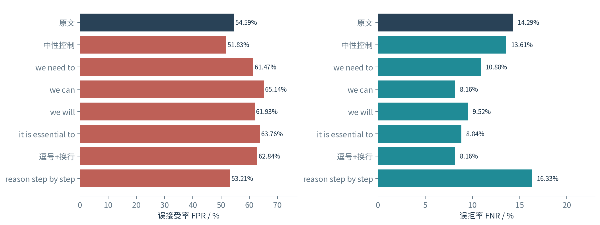
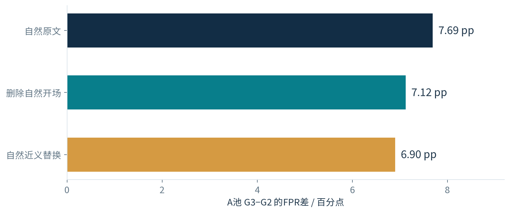
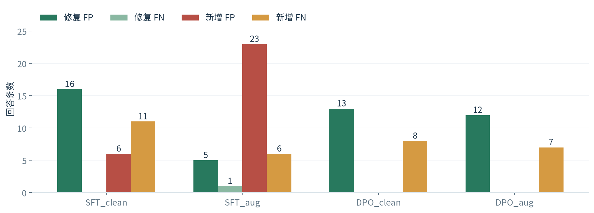

# 迭代合成数学数据中的验证器可靠性

## 跨轮漂移、前缀敏感性与修复探索

**阶段研究总结｜2026年10月20日—27日｜导师交流材料**

### 摘要

本项目研究一个实际问题：当生成器持续利用验证器筛选的合成数据进行更新时，原验证器能否继续可靠地区分正确与错误回答？围绕这一问题，已完成原七天方案的环境、任务诊断、正式生成器更新、验证器更新与独立留出评价，并进一步开展前缀敏感性及修复实验。

目前形成三项主要结果。第一，固定验证器在迭代后的生成器输出上出现可靠性下降：独立留出T上，G0到G2的平衡准确率由72.79%降至69.55%，下降3.24个百分点。第二，保持数学正文和最终答案不变，只添加简短前缀，就能改变验证器判定；例如在C95完整回答面板上，`we can`使误接受率由54.59%升至65.14%，同时使误拒率由14.29%降至8.16%。第三，修复实验呈现明确取舍：DPO能够纠正一部分误接受，但也新增误拒；当前小规模实验中，前缀增强尚未带来优于普通DPO的明确净收益。

项目已从“观察整体指标”推进到“构造保持数学内容不变的干预，并逐条核算修复与损伤”。这一分析框架把自然跨轮变化、局部表达敏感性与验证器更新效果连接起来，为后续研究提供了可复查的实验基础。

## 1. 研究问题与整体路线

合成推理数据常采用“生成—验证—筛选—训练”的循环。验证器决定哪些回答进入下一轮训练，因此其误判既影响当前数据质量，也可能改变后续生成分布。本项目聚焦以下三个问题：

1. **跨轮可靠性：** 固定V0面对G0、G1、G2及扩展G3的输出时，误接受和误拒怎样变化？
2. **表述影响：** 数学内容不变时，常见开场表达、模态词和标点是否会推动验证器改变决定？这些表达又能解释多少自然跨轮差异？
3. **修复效果：** 用内容保持的前缀增强更新V，能够修复多少原有FP/FN，又会新增多少FP/FN？

主线中的G更新使用SFT，验证器V0始终固定。后续V修复另开分支，从原始V0出发，不回写原有G轨迹。

## 2. 七天方案完成情况

| 阶段 | 已完成工作 | 形成的结果 |
|---|---|---|
| Day 1 | 国内镜像测速、环境和模型部署、GSM8K初测、LoRA工程检查 | 建立可运行的生成、独立核验、V评分与训练链路 |
| Day 2 | 复查答案解析，比较GSM8K与MATH | 简单任务自然错误少，继续选择更有辨识度的任务 |
| Day 3 | DAPO百题诊断、坏题隔离、长度检查、A/B/C/T划分 | 冻结正式任务、答案规则、长度、采样与0.5阈值 |
| Day 4—5 | 固定V0进行G0→G1→G2更新，保存跨轮输出 | 完成两轮真实参数更新与数据质量记录；另完成G3扩展 |
| 配套对照 | Oracle、Vmatched、Random三组匹配SFT及缓存分析 | 检查监督可靠性、随机选样与逐题监督权重的影响 |
| Day 6 | 从V0训练随机更新Vrand与定向更新Vtarget | 得到接受倾向过强的负结果，明确更新V也需要保持判别能力 |
| Day 7 | 冻结后统一评价T，完成图表、理由与步骤小样本初审 | 形成独立留出结果、跨轮区间与可追溯案例 |
| 后续补充 | 前缀注入、替换、删除、机制诊断及SFT/DPO修复 | 将异常现象发展为一组可检验的研究问题 |

工程上已实现缓存续跑、tmux后台执行、单卡多进程及双卡生成，并独立配置vLLM。研究统计统一对应具体生成引擎；最终T的四个G均使用同一vLLM设置。

## 3. 模型、数据与评价方法

生成器为**Qwen2.5-Math-1.5B-Instruct**，初始验证器为**Qwen3-4B-Instruct-2507**。经历GSM8K、MATH诊断后，选择DAPO英语竞赛数学题作为主任务。诊断阶段GSM8K的400条回答中只有14条自然错误，MATH的280条中只有33条；DAPO有效开发样本中有212条自然错误，覆盖71道独立题，更适合分析误判。

| 题池 | 规模与用途 | 在研究中的角色 |
|---|---|---|
| A | 600题，G更新候选来源 | 固定V0筛选后，每题至多随机选1条回答更新G |
| B | 200题，V更新数据来源 | 原V更新及本次修复训练，保持与G监督数据分离 |
| C | 原100题；诊断清理后96题，后续主要分析95题 | 开发、机制诊断与前缀实验 |
| T | 原300题；整题排除1道缺图题后299题 | 原七天流程冻结后的独立留出评价 |
| E | 新选64题；整题隔离4道题面疑问题后60题 | 本次SFT/DPO修复的新题评价 |

G每题生成4条候选。正式生成总上下文4096，输出预算不超过3840 token；V使用8192窗口读取完整回答。G0是原始模型；G1、G2、G3分别是沿同一adapter谱系完成一次、两次、三次SFT更新后的状态。A/B/C是题池，G0/G1/G2/G3是模型阶段。

独立正确性标签来自冻结的最终答案提取与精确比较规则。V只接收题目和候选回答，不接收参考答案；通过A/B条件似然评分，固定0.5决定接受或拒绝。无法核验的回答保留未知。

| 指标 | 含义 | 关注的问题 |
|---|---|---|
| FPR = FP/(FP+TN) | 错误回答中被接受的比例 | 验证器放过了多少错误？ |
| FNR = FN/(TP+FN) | 正确回答中被拒绝的比例 | 验证器错杀了多少正确回答？ |
| BA = 1−(FPR+FNR)/2 | 两类错误等权的平衡准确率 | 是否只靠偏向接受或拒绝改善单项指标？ |
| 净修复 | 修复FP+修复FN−新增FP−新增FN | 更新V后，实际少错了多少条？ |

## 4. 主实验：固定V0的跨轮可靠性

### 4.1 G的更新方式与实际训练质量

每轮G在A上生成4个候选，由固定V0筛选，按题至多随机选1条；最多512条、1 epoch。G1从G0开始，G2继续G1，扩展G3继续G2。独立答案标签在选样完成后用于记录质量，不参与主路线筛选。

| 更新后模型 | 训练回答 | 正确/错误/未知 | 可核验部分错误率 | 回答监督token | 优化步 |
|---|---:|---|---:|---:|---:|
| G1 | 500 | 223/259/18 | 53.73% | 414,830 | 63 |
| G2 | 501 | 229/259/13 | 53.07% | 419,895 | 63 |
| G3 | 511 | 226/266/19 | 54.07% | 414,590 | 64 |

实际训练集中约一半可核验回答为错误，说明当前轨迹研究的是**含噪验证反馈下的更新**。这一事实也是后续增加Oracle和随机对照的直接原因。

### 4.2 T299上的统一评价

| G阶段 | G正确率（可核验） | V0 FPR | V0 FNR | V0 BA | 未知比例 |
|---|---:|---:|---:|---:|---:|
| G0 | 39.88% | 45.63% | 8.79% | 72.79% | 4.60% |
| G1 | 41.11% | 45.83% | 9.13% | 72.52% | 6.44% |
| G2 | 40.35% | 48.45% | 12.45% | 69.55% | 5.10% |
| G3（扩展） | 40.58% | 49.55% | 13.07% | 68.69% | 5.43% |

G正确率维持在约40%，V0的判断可靠性却下降。主比较G2−G0的BA差为**−3.24个百分点，95%区间[−6.06, −0.39]**；FNR上升3.65个百分点，区间[+0.36, +7.12]；FPR上升2.82个百分点，区间[−1.72, +7.30]。因此，当前最清楚的跨轮证据是整体平衡准确率下降及误拒增加。

### 4.3 为什么补Oracle和Random对照

从相同G0出发，在共同289道A题上比较Vmatched、Oracle和Random。Oracle只使用最终答案独立核验为正确的已有回答；Vmatched保留原V路线选择；Random不看回答标签或V分数进行长度条件抽样。三组均37步，回答监督预算约22.5万token。

| 分支 | 入训正确/错误/未知 | 回答监督token | C95 G正确率 | 同一V0的FPR | 同一V0的FNR |
|---|---|---:|---:|---:|---:|
| G0（未更新） | — | — | 42.54% | 54.81% | 14.94% |
| Vmatched | 223/63/3 | 225,565 | 38.74% | 52.91% | 17.02% |
| Oracle | 289/0/0 | 225,565 | 40.17% | 53.99% | 13.99% |
| Random | 198/80/11 | 224,951 | 40.56% | 43.93% | 12.33% |

三组未呈现明确的G正确率优势，但Random输出上的V0 FPR更低。进一步缓存分析显示，错误文本的可识别性和逐题监督权重值得关注：总token匹配并不等于每题的监督长度、解法和梯度方向相同。张量审计未发现prompt或最终答案被错误掩码。

同题初审案例提供了一个直观线索：一道有理方程题中，Random回答的错误通分产生明显矛盾，被V拒绝；另两组的推导较连贯，却漏掉零分子分支，被V接受。即使最终正确率相近，错误回答的可识别性也可能不同。

## 5. 从跨轮异常到前缀干预

### 5.1 发现路径

在A池扩展G2→G3中，固定V0的自然FPR由50.15%升至57.84%。围绕“是否存在容易获得接受的表达”，我提出并推进了词语与开场模式分析、注入对照、同义改写、学术词表对照、长度分析以及自然删除实验。

核心干预非常直接：**题目、数学正文和最终答案全部保持，只在回答前加入指定字符串，再比较V0评分和决定。** 最初从原本被V拒绝的错误回答出发，确认了部分表达可以诱发拒绝→接受；随后补全正确回答与全部错误回答，避免仅依据原TN子集理解效果。

### 5.2 完整C95面板：FPR与FNR同时变化

完整面板使用95题×4条G3回答，共380条，其中正确147、错误218、未知15；六个代表前缀、原文和中性控制，共3040条逻辑评分。

| 前缀 | FPR | 相对原文ΔFPR/百分点 | FNR | 相对原文ΔFNR/百分点 |
|---|---:|---:|---:|---:|
| 原文 | 54.59% | 0.00 | 14.29% | 0.00 |
| Response text:（中性） | 51.83% | −2.75 | 13.61% | −0.68 |
| we need to | 61.47% | +6.88 | 10.88% | −3.40 |
| we can | 65.14% | +10.55 | 8.16% | −6.12 |
| we will | 61.93% | +7.34 | 9.52% | −4.76 |
| it is essential to | 63.76% | +9.17 | 8.84% | −5.44 |
| 逗号+换行 | 62.84% | +8.26 | 8.16% | −6.12 |
| Let's reason step by step. | 53.21% | −1.38 | 16.33% | +2.04 |

以`we can`为例，23条原TN变成FP，0条原FP变成TN；同时10条FN变成TP、1条TP变成FN。FPR增幅的95%区间为[+6.60,+14.83]个百分点，FNR变化区间为[−12.07,−1.40]个百分点。五个代表前缀呈现同向的接受偏移，step-by-step类表达则有不同表现。

这一结果揭示：**对错误回答有害的接受偏移，也可能帮助正确回答通过验证。** 精确移除本次人工添加的`we can`可消除23个FP，同时净新增9个FN。因此，词语惩罚或删除策略需要同时核算收益和代价。

### 5.3 系列诊断怎样收束解释

| 候选解释 | 已做对照 | 主要观察 | 形成的判断 |
|---|---|---|---|
| 学术性越强越有效 | 20对AWL词表内外词，统一格式 | A平均翻转2.11% vs 2.81%；C为2.81% vs 3.54% | 所测词对未呈现AWL优势 |
| 越短越有效 | 38前缀的字符、词数、token分析 | 字符相关较明显，token相关弱；同长度表达差别大 | 具体表达与格式比单一长度指标更值得研究 |
| 某类题型独有退化 | 题型、符号与长度分层 | 多组风险上升，未定位到明确独有题型 | 继续关注错误组成与回答层面特征 |
| 触发表达沿训练链富集 | 候选→V接受→实际SFT→G3追踪 | we need to为15.51%→15.85%→16.24%→14.63% | 未出现一致放大的轨迹 |
| 自然开场解释跨轮差距 | 对G2/G3做对称自然删除与替换 | A的FPR差7.69pp，删除后7.12pp、替换后6.90pp | 所测开场只解释了较小部分差距 |
| 越后期越容易被同前缀影响 | 同题、同前缀比较G0—G3 | A平均5.99%→8.85%→9.03%→8.68% | 存在阶段差异，未呈一致单调趋势 |

此外，对自然含目标表达且原V判对的741条回答进行删除和替换，也观察到少量新增FP/FN。综合来看，**局部表达敏感性已经得到直接干预支持；自然跨轮可靠性变化还涉及更广的回答与错误组成。** 这是两个相关、但需要分别研究的层次。

数学上的进一步分析切口，是把总体FPR看作“各类错误的占比×该类错误被接受的概率”的加权和。这样可以分别研究错误组成变化和组内风险变化，而不把总体指标相近理解为所有错误类型都保持稳定。

## 6. 解决思路：用内容保持增强训练验证器

### 6.1 从最初V更新中得到的经验

原七天方案已比较Vrand和Vtarget。T上以G2为例，V0、Vrand、Vtarget的FPR分别为48.45%、83.75%、99.85%，BA分别为69.55%、56.92%、49.96%。更新后的强接受倾向说明，训练loss下降或FNR下降都不足以代表判别能力提升。

据此，新的修复实验采用同前缀覆盖正负回答、仅监督判断标签，并把**修复与新增FP/FN**作为主要评价。

### 6.2 SFT × DPO × 前缀增强的四组对照

四组均从原始V0独立开始，训练使用B/G0的64道题，每题1条正确、1条错误的完整回答，共128条。自然组将原文呈现5次；增强组使用原文加四个前缀版本，均为640次呈现、80步。四个增强前缀为`we need to`、`we can`、`it is essential to`、逗号+换行，同一前缀同等覆盖正确和错误回答。

| 分支 | 输入数据 | 训练目标 | 对照作用 |
|---|---|---|---|
| SFT_clean | 原始正确/错误回答 | 正确A/B标签的交叉熵 | 检查普通监督更新 |
| SFT_aug | 同一回答的原文与前缀版本 | 同上 | 检查SFT中的增强增益 |
| DPO_clean | 原始正确/错误回答 | 正确判断为chosen，错误判断为rejected | 检查偏好目标 |
| DPO_aug | 同一回答的原文与前缀版本 | 同上，参考模型固定V0 | 检查DPO中的增强增益 |

共同使用LoRA r8/alpha16、学习率2e−5、80步；SFT只对1个A/B判断token计算损失，不训练数学正文。DPO的偏好对也位于判断标签上，不把两条数学解答当作chosen/rejected。评价同时覆盖自然回答、已见前缀、未用于增强的前缀和后续G输出。

### 6.3 新E60/G3上的结果

下表比较完全相同的`we can`输入，基准是V0。240条回答中220条可核验，20条未知另存。

| 分支 | 修复FP | 修复FN | 新增FP | 新增FN | 净修复 |
|---|---:|---:|---:|---:|---:|
| SFT_clean | 16 | 0 | 6 | 11 | −1 |
| SFT_aug | 5 | 1 | 23 | 6 | −23 |
| DPO_clean | 13 | 0 | 0 | 8 | +5 |
| DPO_aug | 12 | 0 | 0 | 7 | +5 |

DPO_aug的FPR由34.11%降至24.81%，FNR由8.79%升至16.48%。它减少了误接受，同时新增误拒；BA提高0.81个百分点，95%区间[−3.82,+5.11]。DPO_aug与DPO_clean直接比较，主输入上的净修复差为0。

局部修复也有积极结果：V0在此队列上因`we can`注入新增的7个FP，两组DPO都使这7条在原文和注入版本上同时判断正确；但两组仍会在其他回答上出现新的注入诱发FP，分别为7条和3条。SFT_aug在自然原文及留出前缀上也有损伤。

**本轮解决方案的进展是：DPO显示出减少部分误接受的可行性；下一步需要在保留正确接受的同时，提升修复的净收益与稳定性。当前配方尚未显示出前缀增强的独立收益。**

## 7. 本人的研究贡献与方法来源

### 7.1 本人提出并推进的研究切入

从实际跨轮结果出发，我将总体误判变化拆成了几个可以分别检验的问题：固定V面对不同阶段G的风险变化；常见前缀的内容保持干预；同义、词表、长度和自然删除等竞争解释；以及修复旧错误与破坏旧正确之间的取舍。相关假设和关键对照在研究过程中逐步形成，工程实现、缓存整理和制图由工具辅助完成。

现阶段较有价值的研究增量有三点：

1. **围绕真实SFT反馈轨迹分析验证器。** 将G0—G3自然输出、实际入训数据质量与V可靠性放在同一条可追溯链路中研究。
2. **对最小表述变化做双向风险分析。** 保留完整数学解答与独立答案标签，既测错误回答获得接受，也测正确回答被修复或被误拒，再用自然编辑追查其与跨轮变化的关系。
3. **以修复—新增错误账目评价更新。** 在同题、同回答、同前缀上比较普通/增强SFT与DPO，并用新题检验迁移，明确区分局部修好与整体改善。

这些构成目前的实验设计与分析贡献；后续可围绕其中一个清晰问题继续深化，而不必将所有现象归结为单一触发词机制。

### 7.2 与已有工作的关系

| 相关工作 | 已有研究提供的基础 | 本项目的研究着力点 |
|---|---|---|
| MT-Bench / Chatbot Arena [R1] | 讨论LLM评审的偏差与推理局限 | 在有独立最终答案标签的数学任务上追踪两类错误 |
| AdvJudge-Zero [R2] | 自动发现短控制字符串，并用监督数据加固评审器；也研究附加字符串与RL反馈情形 | 用一组常见表达对完整生成回答做配对干预，连接具体SFT跨轮轨迹，并核算全部FP/FN转移 |
| BITE [R3] | 用语义保持的风格编辑影响评审分数 | 重点分析二元数学验证、未知标签与自然漂移之间的关系 |
| DPO [R4] | 参考模型相对的偏好优化目标 | 将偏好对放在正确/错误判断标签上，与相同数据的SFT做控制比较 |

修复阶段借鉴AdvJudge-Zero的“带干扰表达的正负监督样本＋LoRA加固”思路，以及DPO的标准目标。**本项目的独立工作集中在问题提出、具体干预与对照设计、真实回答数据构造，以及跨轮风险和修复损伤的实证分析。** 本项目还采用不向V提供参考答案的核验接口：标准答案仅作为外部评价标签，V需要依据题目和完整生成回答进行判断。现阶段的创新定位是实验设计与诊断框架，训练目标采用已有方法。上述文献关系基于代表性原论文核对。

## 8. 当前结论与后续研究计划

**已经形成的结论：** 固定V在这一迭代反馈轨迹上出现可靠性下降；部分简短表达能在数学内容不变时推动V更倾向接受；删除这些表达会同时影响FP和FN；现有修复中的DPO有局部收益，但整体净改善与增强收益仍需提升。

后续建议按以下顺序推进：

1. **先区分“更保守”与“更会判断”。** 在开发数据上比较完整风险—保留率曲线和相同FNR/保留率的工作点，结合逐条修复账目评价排序与判别能力。
2. **改进修复数据覆盖。** 保留同一前缀的正负交叉组合，针对新增FN补充正确接受保持样本；把表达家族而非仅字符串划分为训练与留出组。
3. **小规模复现后再扩大。** 复现训练种子，对少量关键案例做人工数学核验；配置确定后使用新题确认，随后再考虑把修复V放回G反馈循环。

最值得继续推进的具体问题是：**如何让验证器对表述变化更稳定，同时保留对数学内容的区分能力？** 当前结果已经提供了明确的失败模式、可操作的训练方案和可直接复用的评估材料。

## 9. 结果口径与复现说明

全文正确性指最终答案核验，完整推理过程另有小样本初审。未知标签单列，坏题按整题处理。主要区间按题配对重采样，同题多个候选一起进入；当前为单条训练轨迹与小规模修复实验。

C用于开发和前缀诊断，T用于原七天冻结后的评价，E用于本次修复的新题评价，三者分别报告。原G轨迹的A数据中后续发现两道题面/参考疑点，既有模型保留；本次V修复在训练题审查后替换3题并统一从V0重跑，初轮与修订产物分别保存。原七天流程还完成20条回答的V理由初审和114段G步骤初审，可作为后续人工复核材料。

原始回答、模型adapter、题池划分、提示、token、连续评分和来源记录均已留存。本次汇总重新读取已有表格和结果，不新增模型训练，不更改原实验指标。

## 10. 阅读材料与数据入口

本目录同时提供：研究总结PDF、可编辑汇报PPT、同版汇报PDF、关键实验结果Excel及图表。Excel首页说明每张表的题池、指标与来源，包含原七天结果、前缀机制对照和四组V修复结果。

主要项目来源：

- [七天收尾与T评价](../week_final_20261026/week_final_report.md)
- [前缀全部发现与实验](../week_final_20261026/prefix_findings_report.md)
- [完整C95前缀面板](../prefix_full_panel_20261026/full_panel_report.md)
- [训练链、自然编辑与答案对照](../closing_diagnostics_20261025/supplementary_evidence_report.md)
- [Oracle对照](../oracle_control_20261022/oracle_control_report.md)与[Random对照](../random_control_20261024/random_control_report.md)
- [缓存、监督权重与两轮误判分析](../cache_followup_20261024/cache_analysis_report.md)
- [SFT/DPO验证器修复](../verifier_robustness_clean_20261026/robust_verifier_report.md)

参考文献（原论文）：

- **[R1]** Zheng et al. *Judging LLM-as-a-Judge with MT-Bench and Chatbot Arena*. NeurIPS 2023. [论文](https://arxiv.org/abs/2306.05685)
- **[R2]** *AdvJudge-Zero: Binary Decision Flips in LLM-as-a-Judge via Adversarial Control Tokens*, v3. [论文](https://arxiv.org/html/2512.17375v3)，监督加固数据见附录A33。
- **[R3]** Yang et al. *Turning Bias into Bugs: Bandit-Guided Style Manipulation Attacks on LLM Judges*. 2026. [论文](https://arxiv.org/abs/2605.26156)
- **[R4]** Rafailov et al. *Direct Preference Optimization: Your Language Model is Secretly a Reward Model*. 2023. [论文](https://arxiv.org/abs/2305.18290)
